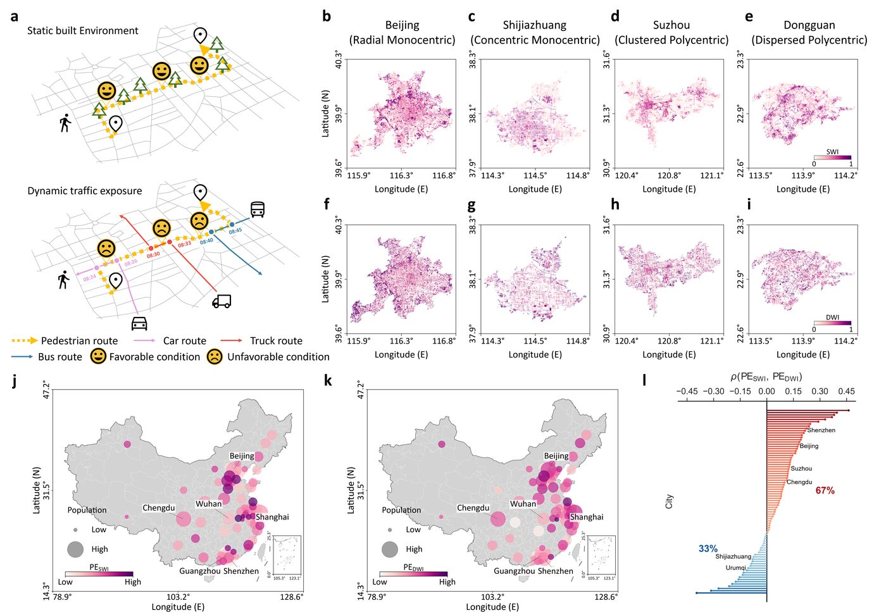

Also on <a href="https://scholar.google.com/citations?user=rMZUM5QAAAAJ">Google Scholar</a> and <a href="https://orcid.org/0000-0002-9650-9981">ORCID</a>. My name is in bold; † equal contribution; * corresponding author.

Highlight

<strong>Yang Y†</strong>, Liu E†, Jia B, Cheng S, Manley E (accepted). Experienced walkability and the paradox of urban density in Chinese cities. <em>Nature Communications</em>. Accepted

<h2 id="first-author">First author (16)</h2>
<ol class="pubs">
<li><strong>Yang Y†</strong>, Liu E†, Jia B, Cheng S, Manley E (accepted). Experienced walkability and the paradox of urban density in Chinese cities. <em>Nature Communications</em>. Accepted<button class="pub-btn pub-tog" data-t="fa0-abs">Abstract</button><button class="pub-btn pub-tog" data-t="fa0-bib">BibTeX</button>
Walkability has long been treated as a property of the urban environment, based on what cities provide rather than what pedestrians encounter during everyday movement. Using mobility data from 128.8 million mobile phone users across 82 Chinese cities, we reconstruct 1.50 billion walking trips and combine them with time-varying vehicular exposure derived from private-mode trips, heavy trucks, and buses. In this large-scale observational study, we find a systematic decoupling between built environment quality and traffic exposure, revealing a density-related walkability paradox: dense, amenity-rich places may support walking through proximity while exposing pedestrians to heavier traffic. The density-related dynamic trade-off is stronger in monocentric cities and attenuated in polycentric ones. Residentially anchored scenario experiments show that amenity localization, built environment improvement, and a traffic-calming index perturbation produce different modeled trade-offs across representative urban contexts. Walkability is not simply a fixed attribute of place, but an outcome of how pedestrians, infrastructure, and traffic interact across urban space.
<pre class="pub-box pub-bib" id="fa0-bib" hidden>@article{yang2026experienced,
  author  = {Yang, Yitao and Liu, Erjian and Jia, Bin and Cheng, Shifen and Manley, Ed},
  title   = {Experienced walkability and the paradox of urban density in Chinese cities},
  journal = {Nature Communications},
  year    = {2026},
  note    = {Accepted}
}</pre></li>
<li><strong>Yang Y</strong>*, He D, Gu Y, He H, Huang W (accepted). WalkGeoAI: Open-source software for estimating street-level relative pedestrian activity using global geospatial data. <em>Computers, Environment and Urban Systems</em>. Accepted<a class="pub-btn" href="https://github.com/UrbanMobility-y/WalkGeoAI">Code</a><a class="pub-btn" href="https://doi.org/10.5281/zenodo.24030782">Zenodo</a><button class="pub-btn pub-tog" data-t="fa1-abs">Abstract</button><button class="pub-btn pub-tog" data-t="fa1-bib">BibTeX</button>
Street-level pedestrian activity data remain unavailable in most cities, limiting evidence-based transport and urban planning. This study introduces WalkGeoAI, an open-source workflow for estimating within-city relative pedestrian activity from globally available geospatial data without local labels, proprietary inputs, or model retraining at deployment. The framework integrates seven open data sources and applies a pretrained Gated Graph Convolutional Network to complete urban road networks. Under spatial block cross-validation, the model achieved Spearman rank correlations of 0.632 in New York City and 0.764 in Beijing against their respective reference proxies. Direct cross-city transfer retained moderate agreement, while comparisons with independent pedestrian counts in London, Philadelphia, and Melbourne produced correlations between 0.519 and 0.584, exceeding a network betweenness baseline in all three cities, whereas a simple amenity density index performed similarly or better. The final pooled model was deployed to 20 cities across six continents, generating estimates for more than 5.7 million road segments. The released software, pretrained model, documentation, and citylevel outputs provide a reproducible basis for preliminary spatial screening, targeted data collection, and local validation.
<pre class="pub-box pub-bib" id="fa1-bib" hidden>@article{yang2026walkgeoai,
  author  = {Yang, Yitao and He, Dongsheng and Gu, Youlong and He, Haitao and Huang, Weiming},
  title   = {WalkGeoAI: Open-source software for estimating street-level relative pedestrian activity using global geospatial data},
  journal = {Computers, Environment and Urban Systems},
  year    = {2026},
  note    = {Accepted}
}</pre></li>
<li><strong>Yang Y</strong>, Liu E, Jia B, Manley E (2026). Multi-layered segregation in urban transportation systems. <em>EPJ Data Science</em>.<a class="pub-btn" href="https://doi.org/10.1140/epjds/s13688-026-00697-4">DOI</a><button class="pub-btn pub-tog" data-t="fa2-abs">Abstract</button><button class="pub-btn pub-tog" data-t="fa2-bib">BibTeX</button>
Urban segregation is increasingly understood as a dynamic process reproduced through daily mobility, yet existing approaches often treat cross-group encounters as occurring within a single or aggregated mobility layer. In reality, sidewalks, roads, buses, and rail often traverse the same physical corridors while carrying distinct residential socioeconomic status (SES) groups, creating parallel layers of mixing and isolation. Here we develop a framework to quantify this layered segregation and apply it to a mobile phone dataset covering 11 million individuals in Beijing, with core analyses based on 6.05 million individuals for whom stable residential and workplace anchors could be inferred. We introduce two indices: the mode-specific mixing index ( MMI ) to measure within-mode diversity, and the multimodal uniformity index ( MUI ) to summarize how evenly mixing is distributed across transport layers. We find that segregation varies sharply by transport mode: rail produces the highest observed mixing by linking disparate neighborhoods, while active travel remains locally sorted. An OD-preserving null model further shows that rail has the smallest mixing deficit relative to the level expected under Beijing’s existing origin–destination, timing, routing, and mode structure, whereas other layers show stronger residential SES sorting. This multi-layered segregation also fluctuates with daily rhythms, becoming more pronounced in peripheral zones and during commuting hours where directionally organized mobility flows amplify social divergence. Exploratory mode-choice simulations suggest that changes in generalized travel costs can redistribute residential SES groups unevenly across mobility layers. This research reveals the social dimensions inherent in transport systems, providing metrics to incorporate modal stratification into urban planning and policy evaluation.
<pre class="pub-box pub-bib" id="fa2-bib" hidden>@article{yang2026multilayered,
  author  = {Yang, Yitao and Liu, Erjian and Jia, Bin and Manley, Ed},
  title   = {Multi-layered segregation in urban transportation systems},
  journal = {EPJ Data Science},
  year    = {2026},
  doi     = {10.1140/epjds/s13688-026-00697-4}
}</pre></li>
<li><strong>Yang Y</strong>, Liu E, Cheng S, Wang H, Chen J (2026). Public transport and the paradox of socioeconomic segregation and diversity. <em>Urban Studies</em>.<a class="pub-btn" href="https://doi.org/10.1177/00420980261460340">DOI</a><button class="pub-btn pub-tog" data-t="fa3-abs">Abstract</button><button class="pub-btn pub-tog" data-t="fa3-bib">BibTeX</button>
Public transport is widely regarded as a means of mitigating the consequences of residential socioeconomic segregation by improving connectivity and creating opportunities for cross-group exposure, yet its dualistic role remains underexplored. Previous studies relying on transit card data capture only origin-destination patterns and overlook the demographic composition of riders along transit corridors. We leverage mobile phone data from 8.3 million users in Beijing, China to reconstruct segment-by-segment travel trajectories and introduce entropy-based metrics measuring neighborhood-based socioeconomic diversity at dual scales: destination-based diversity and in-transit ridership composition. This corridor-level approach captures how ridership composition evolves along each route, revealing variation that aggregate origin-destination analyses obscure. Our analysis reveals two distinct paradoxes. A spatial accessibility–diversity paradox shows that public transport correlates with reduced isolation from wider urban opportunities for peripheral neighborhoods, but moderate accessibility improvements correspond to lower diversity, potentially through preference-based sorting. A temporal peak-hour paradox shows that buses exhibit lower diversity during peak commutes due to homogeneous residential origins, whereas subways consistently show higher diversity across all hours due to hub-based structures and higher capacity. Regression analysis shows urban design characteristics correlate with diversity patterns. These findings offer insights for planning that considers network structure, service timing, and catchment demographics alongside accessibility provision.
<pre class="pub-box pub-bib" id="fa3-bib" hidden>@article{yang2026public,
  author  = {Yang, Yitao and Liu, Erjian and Cheng, Shifen and Wang, Hui and Chen, Junxi},
  title   = {Public transport and the paradox of socioeconomic segregation and diversity},
  journal = {Urban Studies},
  year    = {2026},
  doi     = {10.1177/00420980261460340}
}</pre></li>
<li><strong>Yang Y</strong>*, Cheng S, Chen Y, Huang W (2026). A computational framework for measuring dynamic vehicular exposure and equity in the 15-min city. <em>Computers, Environment and Urban Systems</em>, 129, 102480.<a class="pub-btn" href="https://doi.org/10.1016/j.compenvurbsys.2026.102480">DOI</a><button class="pub-btn pub-tog" data-t="fa4-abs">Abstract</button><button class="pub-btn pub-tog" data-t="fa4-bib">BibTeX</button>
The 15-min city concept promises equitable access to essential services through walkable neighborhoods, yet traditional accessibility assessments fail to capture the dynamic impact of vehicular exposure on pedestrian experiences. This study introduces a novel computational framework that measures near-real-time, path-specific vehicular exposure during individual walking journeys by integrating large-scale mobility datasets including mobile phone trajectories (approximately 50% population coverage), GPS data from heavy trucks (75% coverage), and comprehensive public transit schedules in Beijing, China. We develop multi-scale exposure indices that distinguish between cars, trucks, and buses at road, location, and individual trip levels, revealing systematic inequities across socioeconomic groups: higher-income groups face intense car risks in amenity-rich urban areas, while lower-income groups are disproportionately burdened by truck traffic. Critically, we model an access gap that quantifies how traffic avoidance behavior constrains walkable access, revealing that vehicular exposure creates invisible barriers that systematically reduce the practical reach of the 15-min city. These findings compel a reinterpretation of walkability—from mere proximity to an experiential quality—and provide essential insights to identify and mitigate the environmental injustices that undermine equitable urban design.
<pre class="pub-box pub-bib" id="fa4-bib" hidden>@article{yang2026a,
  author  = {Yang, Yitao and Cheng, Shifen and Chen, Yan and Huang, Weiming},
  title   = {A computational framework for measuring dynamic vehicular exposure and equity in the 15-min city},
  journal = {Computers, Environment and Urban Systems},
  year    = {2026},
  volume  = {129},
  doi     = {10.1016/j.compenvurbsys.2026.102480}
}</pre></li>
<li><strong>Yang Y</strong>, Cheng S, Meng X, Yang Z, Chen Y (2026). Transportation resilience through cascading adaptation: national-scale evidence from China. <em>Transportation Research Part E: Logistics and Transportation Review</em>, 211, 104906.<a class="pub-btn" href="https://doi.org/10.1016/j.tre.2026.104906">DOI</a><button class="pub-btn pub-tog" data-t="fa5-abs">Abstract</button><button class="pub-btn pub-tog" data-t="fa5-bib">BibTeX</button>
Transportation networks are critical infrastructure systems whose resilience determines regional freight connectivity and supply chain stability during major disruptions. While existing research has focused primarily on cascading failures, this study documents and quantifies a complementary empirical pattern, i.e., cascading adaptation, whereby freight flows across a national highway network sequentially reorganized to maintain functionality when core nodes are disrupted. We examine this phenomenon through the 2022 Shanghai lockdown, analyzing how China’s highway transportation network responded to the prolonged shutdown of a major logistics hub. Using 701,468,432 highway toll records covering nationwide freight movements, we develop a multi-scalar analytical framework to assess city-level freight disruption, dependency relationships, and propagation effects through hierarchical network structures. Our findings reveal a fundamental disconnect between direct freight dependency on Shanghai and actual vulnerability, suggesting that systemic risks propagate through complex, higher-order network pathways. Rather than experiencing uniform cascading failure, the network exhibited sequential flow redistribution consistent with adaptive reorganization: secondary hubs like Hangzhou emerged as alternative regional centers, while peripheral cities absorbed displaced flows and exceeded baseline activity levels. The extent of this adaptive response varied by regional structure: polycentric urban agglomerations demonstrated faster recovery trajectories, while hub-centric regions experienced prolonged disruption. These results advance understanding of freight network resilience by providing large-scale descriptive evidence for flow redistribution dynamics following hub disruption, offering empirically grounded observations relevant to resilient transportation planning.
<pre class="pub-box pub-bib" id="fa5-bib" hidden>@article{yang2026transportation,
  author  = {Yang, Yitao and Cheng, Shifen and Meng, Xin and Yang, Zhenzhen and Chen, Yan},
  title   = {Transportation resilience through cascading adaptation: national-scale evidence from China},
  journal = {Transportation Research Part E: Logistics and Transportation Review},
  year    = {2026},
  volume  = {211},
  doi     = {10.1016/j.tre.2026.104906}
}</pre></li>
<li><strong>Yang Y</strong>, Nadi A, Song D, Cebeci MS, Jia B, de Bok MA, Tavasszy LA (2026). Uncovering heterogeneous decision-making in truck tour organization: A shipment-based behavioral modeling approach. <em>Transport Policy</em>, 178, 103958.<a class="pub-btn" href="https://doi.org/10.1016/j.tranpol.2025.103958">DOI</a><button class="pub-btn pub-tog" data-t="fa6-abs">Abstract</button><button class="pub-btn pub-tog" data-t="fa6-bib">BibTeX</button>
The efficient movement of freight trucks is vital for modern logistics, where the organization of truck tours is central to optimizing supply chain operations and minimizing transportation costs. The truck tour patterns embody a complex interplay of diverse decision-making factors, reflecting the effectiveness of transport and logistics planning initiatives. Despite previous research efforts, an in-depth analysis of understanding how various decision-making factors, such as time of the day and product type, interact and their heterogeneous effects on shaping truck tour patterns is still lacking. This limitation hinders the development of more effective and sustainable strategies for freight transportation. In this paper, by leveraging large-scale carrier and shipment dataset in the Netherlands, we capture and analyze the heterogeneity of over 1000 diverse tour patterns of freight trucks in terms of temporal, spatial, and shipment requirements characteristics. We further introduce a novel modeling approach using random parameters logit models with heterogeneity in means and variances to uncover the heterogeneous effects of various factors on the choice of truck tour patterns. The model results highlight the multifaceted nature of truck travel behaviors, offering practical implications for logistics operations, policy development and freight planning.
<pre class="pub-box pub-bib" id="fa6-bib" hidden>@article{yang2026uncovering,
  author  = {Yang, Yitao and Nadi, Ali and Song, Dongdong and Cebeci, Merve Seher and Jia, Bin and de Bok, Michiel and Tavasszy, Lóránt A.},
  title   = {Uncovering heterogeneous decision-making in truck tour organization: A shipment-based behavioral modeling approach},
  journal = {Transport Policy},
  year    = {2026},
  volume  = {178},
  doi     = {10.1016/j.tranpol.2025.103958}
}</pre></li>
<li><strong>Yang Y</strong>, Chen Y, Bai Y, Liu J, Cheng S (2025). Mobility data uncover spillover impacts of freight activities on urban neighborhoods. <em>Sustainable Cities and Society</em>, 135, 107032.<a class="pub-btn" href="https://doi.org/10.1016/j.scs.2025.107032">DOI</a><button class="pub-btn pub-tog" data-t="fa7-abs">Abstract</button><button class="pub-btn pub-tog" data-t="fa7-bib">BibTeX</button>
Comprehensive assessment of the negative impacts associated with city road freight is essential for promoting sustainable city development. Previous research has primarily focused on specific regional scales, specifically examining the direct impacts of concentrated truck activities on high-demand areas, overlooking the broader city context. In reality, trucks commonly traverse through multiple neighborhoods during their journeys, contributing to a complex web of freight spillover impacts that are not easily captured from aggregated OD demands. This highlights the need for a detailed analysis of individual truck mobility dynamics to better understand the full scope of freight impacts within city environments. Here we collect the GPS data from over 2.6 million trucks in Chinese cities, providing a granular freight impacts assessment framework. By employing the concept of activity space and network analysis method, we reveal that even regions with low freight demand experience significant spillover impacts from truck activities in freight hotspots. To further understand the truck behavioral mechanisms that contribute to freight spillover impacts, we develop a gravity-based exploration and preferential return (EPR) model to simulate truck routing behaviors. Finally, coupled with model simulation, several potential strategies are provided to mitigate freight negative impacts and promote city sustainability.
<pre class="pub-box pub-bib" id="fa7-bib" hidden>@article{yang2025mobility,
  author  = {Yang, Yitao and Chen, Yan and Bai, Yihang and Liu, Jialin and Cheng, Shifen},
  title   = {Mobility data uncover spillover impacts of freight activities on urban neighborhoods},
  journal = {Sustainable Cities and Society},
  year    = {2025},
  volume  = {135},
  doi     = {10.1016/j.scs.2025.107032}
}</pre></li>
<li><strong>Yang Y</strong>, Liu E, Chen Y, Meng X, Wang T, Wang H, Zhi D, Song D, Wang H (2025). Assessing the resilience of urban truck transport networks under the COVID-19 pandemic: A case study of China. <em>Transportation Research Part E: Logistics and Transportation Review</em>, 197, 104087.<a class="pub-btn" href="https://doi.org/10.1016/j.tre.2025.104087">DOI</a><button class="pub-btn pub-tog" data-t="fa8-abs">Abstract</button><button class="pub-btn pub-tog" data-t="fa8-bib">BibTeX</button>
The COVID-19 pandemic underscores the critical role of urban truck transport networks in maintaining essential supply chains amidst crises. However, existing research on the resilience of these networks is limited, often relying on aggregated socio-economic data to provide an overview of broader trends. This study addresses the gap by utilizing a large-scale GPS dataset of individual trucks from Chinese cities, enabling a micro-level analysis of urban truck transport network resilience under pandemic. First, we examine how pandemic-induced disruptions reshaped the spatial distribution of freight activities, identifying demand pattern shifts in the city. Second, we introduce two key resilience metrics—handling efficiency and transport efficiency—to determine whether truck transport networks could adapt to fluctuating demand and maintain reliable service across regions, freight hubs, and industry-specific supply chains. The findings reveal significant variations in network resilience across cities, with suburban hubs and critical industries demonstrating higher adaptability, while urban hubs and non-essential sectors faced greater challenges. By providing a micro-level perspective and quantifiable resilience metrics, this study advances the understanding of urban logistics resilience and provides practical insights for policymakers to enhance supply chain reliability in the face of future disruptions.
<pre class="pub-box pub-bib" id="fa8-bib" hidden>@article{yang2025assessing,
  author  = {Yang, Yitao and Liu, Erjian and Chen, Yan and Meng, Xin and Wang, Ting and Wang, Hui and Zhi, Danyue and Song, Dongdong and Wang, Hao},
  title   = {Assessing the resilience of urban truck transport networks under the COVID-19 pandemic: A case study of China},
  journal = {Transportation Research Part E: Logistics and Transportation Review},
  year    = {2025},
  volume  = {197},
  doi     = {10.1016/j.tre.2025.104087}
}</pre></li>
<li><strong>Yang Y</strong>, Jia B, Yang Z, Yan X-Y, Zheng S-T, Liu J, Song D, Ji H, Gao Z (2024). Revealing the impacts of COVID-19 pandemic on intercity truck transport: New insights from big data analytics. <em>Transportation Research Part C: Emerging Technologies</em>, 169, 104861.<a class="pub-btn" href="https://doi.org/10.1016/j.trc.2024.104861">DOI</a><button class="pub-btn pub-tog" data-t="fa9-abs">Abstract</button><button class="pub-btn pub-tog" data-t="fa9-bib">BibTeX</button>
Intercity truck transport emerged as a crucial lifeline for maintaining city operations during COVID-19 pandemic. Understanding pandemic-imposed impacts on intercity truck transport can inform policymakers in crafting more effective strategies for future crises and disruptions. However, to our best knowledge, previous research predominantly focused on freight movements under normal circumstances. Due to the data limitation, the pandemic-related studies commonly relied on freight survey and focused on specific industries, which cannot capture the full spectrum of factors influencing freight trip generation (FTG) during the pandemic. Here, a novel dataset capturing large-scale individual truck movements during the COVID-19 pandemic is provided. By leveraging the mobility dataset, pandemic-induced changes in truck transport demand structure are quantified using spatial statistical methods. Furthermore, an interpretable machine learning framework for intercity freight demand estimation is developed, revealing the complex interplay of factors that influence and shape the behavior shifts of intercity truck transport systems due to the pandemic outbreak. The findings suggest significant changes in various factors influencing intercity truck movements across local and broader regions, emphasizing city-specific challenges amidst pandemic. The developed FTG model could serve as a tool to predict freight demand between cities for future crises and to support policymaking in the practice of freight management.
<pre class="pub-box pub-bib" id="fa9-bib" hidden>@article{yang2024revealing,
  author  = {Yang, Yitao and Jia, Bin and Yang, Zhenzhen and Yan, Xiao-Yong and Zheng, Shi-Teng and Liu, Jialin and Song, Dongdong and Ji, Hao and Gao, Ziyou},
  title   = {Revealing the impacts of COVID-19 pandemic on intercity truck transport: New insights from big data analytics},
  journal = {Transportation Research Part C: Emerging Technologies},
  year    = {2024},
  volume  = {169},
  doi     = {10.1016/j.trc.2024.104861}
}</pre></li>
<li><strong>Yang Y</strong>, Chen Y, Lv Y-Y, Jia X, Lin X-J, Yan X-Y, Jia B, Manley E (2024). Quantifying city freight mobility segregation associated with truck multi-tours behavior. <em>Sustainable Cities and Society</em>, 113, 105699.<a class="pub-btn" href="https://doi.org/10.1016/j.scs.2024.105699">DOI</a><button class="pub-btn pub-tog" data-t="fa10-abs">Abstract</button><button class="pub-btn pub-tog" data-t="fa10-bib">BibTeX</button>
Freight mobility segregation, a phenomenon like residential social segregation, is a crucial aspect of city landscapes that influences the livability and sustainability of cities. However, there is a deficiency in understanding the intrinsic complexity of freight mobility segregation, particularly regarding the micro-level truck behaviors. In this study, we develop a new approach to assess the degree of freight mobility segregation within cities by leveraging large-scale truck GPS data in Chinese cities. The analysis indicates the existence of freight mobility segregation in cities, where certain groups of trucks serve high-demand areas, while another group of trucks serves low-demand areas. The activity spaces of distinct truck groups are largely non-overlapping or segregated. To uncover the correlations between mobility segregation and truck operational patterns, we introduce two metrics to characterize truck multi-tours behavior, focusing on tour pattern predictability and activity explorability. By employing freight point-of-interest (POI) data, we further reveal the influence of local economic structures and industrial compositions on mobility segregation in cities. These findings enrich our understanding of the dynamics of city freight systems, offering implications for improving logistics efficiency and fostering sustainable city development.
<pre class="pub-box pub-bib" id="fa10-bib" hidden>@article{yang2024quantifying,
  author  = {Yang, Yitao and Chen, Yan and Lv, Ying-Yue and Jia, Xiang-Yu and Lin, Xu-Jie and Yan, Xiao-Yong and Jia, Bin and Manley, Ed},
  title   = {Quantifying city freight mobility segregation associated with truck multi-tours behavior},
  journal = {Sustainable Cities and Society},
  year    = {2024},
  volume  = {113},
  doi     = {10.1016/j.scs.2024.105699}
}</pre></li>
<li><strong>Yang Y</strong>, Jia B, Yan X-Y, Chen Y, Tavasszy LA, de Bok MA, Bai Z, Liu E, Gao Z (2024). Structure and dynamics of urban freight truck movements: A complex network theory perspective. <em>Transportation Research Part C: Emerging Technologies</em>, 158, 104442.<a class="pub-btn" href="https://doi.org/10.1016/j.trc.2023.104442">DOI</a><button class="pub-btn pub-tog" data-t="fa11-abs">Abstract</button><button class="pub-btn pub-tog" data-t="fa11-bib">BibTeX</button>
Knowledge of the core structure and inherent dynamics of urban freight transport systems is important for the development of policies, aimed at improving the livability and sustainability of cities. The past decade has witnessed a great deal of efforts into analyzing the geographic structure of urban freight transport systems. However, in-depth studies on the system core structure and underlying dynamics are still absent. This study contributes to the field by analyzing large scale freight truck trip data from Chinese cities, using complex network analysis. We empirically reconstruct and characterize the urban freight truck mobility networks and reveal the underlying spatial interaction patterns. We develop a spatial network growth model which explains how hub-and-spoke core structure of urban freight transport systems are formed. The developed model captures the essential interaction dynamics of freight locations, and explains the effects of spatial distance, economic size and business pattern replication. Inspired by the model, we provide policy implications for land-use planning, transportation planning and sustainable urban development.
<pre class="pub-box pub-bib" id="fa11-bib" hidden>@article{yang2024structure,
  author  = {Yang, Yitao and Jia, Bin and Yan, Xiao-Yong and Chen, Yan and Tavasszy, Lóránt and de Bok, Michiel and Bai, Zhuotong and Liu, Erjian and Gao, Ziyou},
  title   = {Structure and dynamics of urban freight truck movements: A complex network theory perspective},
  journal = {Transportation Research Part C: Emerging Technologies},
  year    = {2024},
  volume  = {158},
  doi     = {10.1016/j.trc.2023.104442}
}</pre></li>
<li><strong>Yang Y</strong>, Jia B, Yan X-Y, Zhi D, Song D, Chen Y, de Bok MA, Tavasszy LA, Gao Z (2023). Uncovering and modeling the hierarchical organization of urban heavy truck flows. <em>Transportation Research Part E: Logistics and Transportation Review</em>, 179, 103318.<a class="pub-btn" href="https://doi.org/10.1016/j.tre.2023.103318">DOI</a><button class="pub-btn pub-tog" data-t="fa12-abs">Abstract</button><button class="pub-btn pub-tog" data-t="fa12-bib">BibTeX</button>
Knowledge of the hierarchical organization of urban heavy truck flows is important for understanding the structure of urban freight system and underlying interactions dynamics, providing insights to assess and develop freight policies. The complexity and dynamic nature of urban freight system pose significant challenges in comprehensively capturing structured arrangement of heavy truck movements. In this paper, we uncover the hierarchical organization of urban heavy truck flows by using complex network theory. We use large-scale heavy truck GPS data and urban freight location point-of-interest (POI) data to construct urban heavy truck mobility networks, and detect their community structure. The empirical results suggest different sets of locations are closely linked to each other to form multiple clusters. By integrating the categories of locations, we reveal the cluster-specific industry concentration and industry-specific location roles, informing evidence-based policy formulation. To capture the interaction dynamics of locations, we develop a spatial network growth model that considers the spatial agglomeration of industrial clusters and interaction pattern of locations. The model provides a mathematical tool to simulate the formation process of real-world networks for logistics planning and management.
<pre class="pub-box pub-bib" id="fa12-bib" hidden>@article{yang2023uncovering,
  author  = {Yang, Yitao and Jia, Bin and Yan, Xiao-Yong and Zhi, Danyue and Song, Dongdong and Chen, Yan and de Bok, Michiel and Tavasszy, Lóránt A. and Gao, Ziyou},
  title   = {Uncovering and modeling the hierarchical organization of urban heavy truck flows},
  journal = {Transportation Research Part E: Logistics and Transportation Review},
  year    = {2023},
  volume  = {179},
  doi     = {10.1016/j.tre.2023.103318}
}</pre></li>
<li><strong>Yang Y</strong>, Jia B, Yan X-Y, Chen Y, Song D, Zhi D, Wang Y, Gao Z (2023). Estimating intercity heavy truck mobility flows using the deep gravity framework. <em>Transportation Research Part E: Logistics and Transportation Review</em>, 179, 103320.<a class="pub-btn" href="https://doi.org/10.1016/j.tre.2023.103320">DOI</a><button class="pub-btn pub-tog" data-t="fa13-abs">Abstract</button><button class="pub-btn pub-tog" data-t="fa13-bib">BibTeX</button>
Accurate estimation of intercity heavy truck mobility flows is of vital importance to urban planning, transportation management and logistics operations. The inaccessibility of big data related to intercity transport systems and the heterogeneity of trucking activities pose challenges for the reliable estimation. Recently, the advance of Artificial Intelligence (AI) provides a potential solution to this problem. However, most previous studies focused on the estimation of inter-regional passenger mobility. In-depth studies of estimating intercity heavy truck mobility flows by using deep learning techniques are still scarce. To fill in the gaps, we construct a deep neural network based on the Deep Gravity framework, an advanced predictive model for human mobility. We collect a wide range of data related to heavy truck movements, freight locations, road networks and land uses to train the model, and validate its high performance by comparing to traditional gravity model. Furthermore, we use an explainable AI technique to interpret how the city features contribute to the determination of intercity heavy truck movements, and the results can provide valuable policy implications for logistics operations, businesses and urban planning.
<pre class="pub-box pub-bib" id="fa13-bib" hidden>@article{yang2023estimating,
  author  = {Yang, Yitao and Jia, Bin and Yan, Xiao-Yong and Chen, Yan and Song, Dongdong and Zhi, Danyue and Wang, Yiyun and Gao, Ziyou},
  title   = {Estimating intercity heavy truck mobility flows using the deep gravity framework},
  journal = {Transportation Research Part E: Logistics and Transportation Review},
  year    = {2023},
  volume  = {179},
  doi     = {10.1016/j.tre.2023.103320}
}</pre></li>
<li><strong>Yang Y</strong>, Jia B, Yan X-Y, Jiang R, Ji H, Gao Z (2022). Identifying intracity freight trip ends from heavy truck GPS trajectories. <em>Transportation Research Part C: Emerging Technologies</em>, 136, 103564.<a class="pub-btn" href="https://doi.org/10.1016/j.trc.2022.103564">DOI</a><button class="pub-btn pub-tog" data-t="fa14-abs">Abstract</button><button class="pub-btn pub-tog" data-t="fa14-bib">BibTeX</button>
Intracity heavy truck freight trips are basic data in city freight system planning and management. In the big data era, massive heavy truck GPS trajectories can be acquired cost effectively in realtime. Identifying freight trip ends (origins and destinations) from heavy truck GPS trajectories is an outstanding problem. Although previous studies proposed a variety of trip end identification methods from different perspectives, these studies subjectively defined key threshold parameters and ignored the complex intracity heavy truck travel characteristics. Here, we propose a datadriven trip end identification method in which the speed threshold for identifying truck stops and the multilevel time thresholds for distinguishing temporary stops and freight trip ends are objectively defined. Moreover, an appropriate time threshold level is dynamically selected by considering the intracity activity patterns of heavy trucks. Furthermore, we use urban road networks and Point-of-Interest (POI) data to eliminate long-stay temporary stops to improve method accuracy. The validation results show that the accuracy of the method we propose is 88.79%. Our method incorporates the impact of the city freight context on truck trajectory characteristics, and its results can reflect the spatial distribution and chain patterns of intracity heavy truck freight trips, which have a wide range of practical applications.
<pre class="pub-box pub-bib" id="fa14-bib" hidden>@article{yang2022intracity,
  author  = {Yang, Yitao and Jia, Bin and Yan, Xiao-Yong and Jiang, Rui and Ji, Hao and Gao, Ziyou},
  title   = {Identifying intracity freight trip ends from heavy truck GPS trajectories},
  journal = {Transportation Research Part C: Emerging Technologies},
  year    = {2022},
  volume  = {136},
  doi     = {10.1016/j.trc.2022.103564}
}</pre></li>
<li><strong>Yang Y</strong>, Jia B, Yan X-Y, Li J, Yang Z, Gao Z (2022). Identifying intercity freight trip ends of heavy trucks from GPS data. <em>Transportation Research Part E: Logistics and Transportation Review</em>, 157, 102590.<a class="pub-btn" href="https://doi.org/10.1016/j.tre.2021.102590">DOI</a><button class="pub-btn pub-tog" data-t="fa15-abs">Abstract</button><button class="pub-btn pub-tog" data-t="fa15-bib">BibTeX</button>
The intercity freight trips of heavy trucks are basic data for transportation system planning and management. In recent decades, extracting intercity freight trips from GPS data has gradually become the main alternative to traditional surveys. Identifying freight trip ends (origin and destination) is the first task in trip extraction. Although many trip end identification methods have been proposed in previous studies, most of these studies subjectively determined key parameters and ignored the complex characteristics of truck trajectory and freight activities. In this paper, we propose a data-driven trip end identification method based on massive GPS data of heavy trucks in China. First, we capture heavy truck trajectory characteristics under the influence of GPS drift to identify truck stops from GPS data. Second, we analyze the temporal characteristics of truck activities and use freight-related point-of-interest (POI) data and highway network GIS data to identify valid trip ends from truck stops. The results of method validation suggest that the accuracy of our proposed method is significantly improved in comparison with the benchmark methods. We further extract intercity freight trips from the identified trip ends and analyze the spatiotemporal characteristics of intercity freight trips in China.
<pre class="pub-box pub-bib" id="fa15-bib" hidden>@article{yang2022intercity,
  author  = {Yang, Yitao and Jia, Bin and Yan, Xiao-Yong and Li, Jiangtao and Yang, Zhenzhen and Gao, Ziyou},
  title   = {Identifying intercity freight trip ends of heavy trucks from GPS data},
  journal = {Transportation Research Part E: Logistics and Transportation Review},
  year    = {2022},
  volume  = {157},
  doi     = {10.1016/j.tre.2021.102590}
}</pre></li>
</ol>

<h2 id="co-author">Co-author (22)</h2>
<ol class="pubs">
<li>Miao R, Cheng S, Zhao Y, <strong>Yang Y</strong>, Lu F (2026). Task-aligned mixture-of-experts modeling for heterogeneous origin–destination flow prediction. <em>Journal of Geovisualization and Spatial Analysis</em>, 10, 46.<a class="pub-btn" href="https://doi.org/10.1007/s41651-026-00290-3">DOI</a><button class="pub-btn pub-tog" data-t="co0-bib">BibTeX</button><pre class="pub-box pub-bib" id="co0-bib" hidden>@article{miao2026taskaligned,
  author  = {Miao, Runyu and Cheng, Shifen and Zhao, Yibo and Yang, Yitao and Lu, Feng},
  title   = {Task-aligned mixture-of-experts modeling for heterogeneous origin–destination flow prediction},
  journal = {Journal of Geovisualization and Spatial Analysis},
  year    = {2026},
  volume  = {10},
  pages   = {46},
  doi     = {10.1007/s41651-026-00290-3}
}</pre></li>
<li>Cheng S, Miao R, Zhao Y, <strong>Yang Y</strong>, Liu J, Lu F (2026). Spatially stratified modeling of intercity road freight flows in China. <em>Journal of Transport Geography</em>, 134, 104661.<a class="pub-btn" href="https://doi.org/10.1016/j.jtrangeo.2026.104661">DOI</a><button class="pub-btn pub-tog" data-t="co1-bib">BibTeX</button><pre class="pub-box pub-bib" id="co1-bib" hidden>@article{cheng2026spatially,
  author  = {Cheng, Shifen and Miao, Runyu and Zhao, Yibo and Yang, Yitao and Liu, Junnan and Lu, Feng},
  title   = {Spatially stratified modeling of intercity road freight flows in China},
  journal = {Journal of Transport Geography},
  year    = {2026},
  volume  = {134},
  doi     = {10.1016/j.jtrangeo.2026.104661}
}</pre></li>
<li>Lin X-J, <strong>Yang Y</strong>, Nie W-P, Yan X-Y (2026). Scaling law of individual urban tour behavior. <em>Physical Review E</em>, 113, 034303.<a class="pub-btn" href="https://doi.org/10.1103/9d5z-9xxt">DOI</a><button class="pub-btn pub-tog" data-t="co2-abs">Abstract</button><button class="pub-btn pub-tog" data-t="co2-bib">BibTeX</button>
Analyzing and modeling the mobility process with tour behavior is fundamental to understanding a wide range of complex systems, including animal foraging, human mobility, and freight transportation. However, despite their importance, the distribution of tour length has long been neglected in individual human mobility models. To fill this gap, we analyze Foursquare users&#x27; check-in data and find that the distribution of urban tour length follows a truncated power-law distribution. To reproduce the universal scaling law for human mobility in urban areas, we introduce a tour terminate-continue model. Our model reproduces not only the urban tour length distribution, but also Heaps&#x27; law, Zipf&#x27;s law, and the distribution of the radius of gyration, providing an additional perspective for characterizing individual human mobility.
<pre class="pub-box pub-bib" id="co2-bib" hidden>@article{lin2026scaling,
  author  = {Lin, Xu-Jie and Yang, Yitao and Nie, Wei-Peng and Yan, Xiao-Yong},
  title   = {Scaling law of individual urban tour behavior},
  journal = {Physical Review E},
  year    = {2026},
  volume  = {113},
  pages   = {034303},
  doi     = {10.1103/9d5z-9xxt}
}</pre></li>
<li>Song D, Feng J, Liu Y, <strong>Yang Y</strong>, Zhi D, Ran B, Jiang D (2026). Analysis of duration between crashes among repeatedly crash-involved drivers using alternate unobserved-heterogeneity modeling approaches. <em>Accident Analysis &amp; Prevention</em>, 230, 108472.<a class="pub-btn" href="https://doi.org/10.1016/j.aap.2026.108472">DOI</a><button class="pub-btn pub-tog" data-t="co3-abs">Abstract</button><button class="pub-btn pub-tog" data-t="co3-bib">BibTeX</button>
Repeatedly crash-involved drivers, due to their short inter-crash durations and high crash frequencies, represent a critical risk to public safety. Identifying the significant factors influencing crash recurrence is therefore of fundamental importance for reducing crash frequency. Using traffic accident records from a city in Inner Mongolia, China, from 2014 to 2023, we analyze drivers involved in two or more crashes and examine the factors influencing their inter-crash durations. To address unobserved heterogeneity, two alternate modeling approaches are applied: a correlated random-parameters survival model with mean heterogeneity and a latent-class survival model based on class probability functions. Both models effectively capture multilayered unobserved heterogeneity of the crash data. The correlated random-parameters model identifies heterogeneous effects for spring and novice drivers, with a strong correlation between random parameters (0.746, p &lt; 0.001) significantly influencing crash intervals. Other factors-such as previous PDO crashes, young drivers, truck driving, hilly terrain, median barrier, wet roads, and darkness with lights unlit-exert significant but homogeneous effects. The latent class survival analysis model identifies two distinct latent classes (Latent Class 1 with class membership probability of 0.577 and Latent Class 2 with class membership probability of 0.423) at a 0.001 significance level. And substantial differences are observed in the effects of explanatory variables on accident recurrence intervals across the classes. For instance, previous PDO crashes shorten recurrence durations in Class 1 (-0.789) but lengthen them in Class 2 (0.788); similarly, the wet-road indicator reduces recurrence in Class 1 (-0.815) yet increases it in Class 2 (1.040). Furthermore, estimation results from both heterogeneity-based models indicate that most fixed-effect variables share consistent directional signs, However, the average effect size differs substantially. For example, the effect of the Low visibility indicator is 1.199 in the random-parameters model compared to 0.189 in Class 2 of the latent-class model, while darkness with lights unlit yields -0.526 and -0.250 (Class 2), respectively. By applying two advanced econometric modeling approaches, this study offers a novel theoretical perspective on capturing heterogeneity in inter-crash durations among repeatedly crash-involved drivers. Meanwhile, the key determinants identified through these models provide a robust scientific foundation for developing precision risk-intervention strategies, thereby supporting more targeted behavioral interventions for high-risk driver groups.
<pre class="pub-box pub-bib" id="co3-bib" hidden>@article{song2026analysis,
  author  = {Song, Dongdong and Feng, Jing and Liu, Yongtao and Yang, Yitao and Zhi, Danyue and Ran, Bin and Jiang, Deyin},
  title   = {Analysis of duration between crashes among repeatedly crash-involved drivers using alternate unobserved-heterogeneity modeling approaches},
  journal = {Accident Analysis &amp;amp; Prevention},
  year    = {2026},
  volume  = {230},
  doi     = {10.1016/j.aap.2026.108472}
}</pre></li>
<li>Luo X, Cheng S, <strong>Yang Y</strong>, Wang P, Guo S, Lu F (2026). Heterogeneity-guided tensor decomposition for traffic flow imputation. <em>IEEE Transactions on Intelligent Transportation Systems</em>, 27, 7044–7061.<a class="pub-btn" href="https://doi.org/10.1109/tits.2026.3658186">DOI</a><button class="pub-btn pub-tog" data-t="co4-abs">Abstract</button><button class="pub-btn pub-tog" data-t="co4-bib">BibTeX</button>
Tensor decomposition has been widely recognized as a promising approach for addressing missing data in traffic flow analysis. Recent studies have demonstrated its effectiveness in capturing complex spatiotemporal patterns and improving imputation accuracy. However, two challenges still remain: i) The spatiotemporal heterogeneity at missing locations is difficult to identify and accurately represent, preventing the model from optimizing based on the true data distribution; ii) The lack of a dynamic feedback mechanism hinders the model to adaptively optimize its spatiotemporal representation based on imputation results, thus limiting the generalization and robustness. This paper proposes a heterogeneity-guided tensor decomposition method (Hg-TD) to address these problems. First, we design a spatiotemporal-decoupled masking and encoding strategy, leveraging contrastive learning based on reconstruction loss to generate a dynamic spatial weight matrix, thereby enhancing the representation of spatiotemporal heterogeneity at missing locations. Second, we introduce a dynamic feedback-driven self-supervised learning mechanism that uses imputation results as feedback to dynamically optimize both representation learning and tensor decomposition, allowing the model to adaptively adjust spatiotemporal constraints, thereby improving imputation performance under sparse and non-stationary data conditions. Experimental results on four traffic flow datasets from urban areas demonstrate that Hg-TD consistently surpasses fifteen baseline models across various data missing patterns, and achieves a favorable balance between computational complexity and imputation performance. The improvement relative to the baselines is particularly pronounced under conditions of severe data missingness. Codes and datasets are available at https://figshare.com/s/17b6beeb8e8bad5e3ee7
<pre class="pub-box pub-bib" id="co4-bib" hidden>@article{luo2026heterogeneityguided,
  author  = {Luo, Xiaoyue and Cheng, Shifen and Yang, Yitao and Wang, Peixiao and Guo, Shengmin and Lu, Feng},
  title   = {Heterogeneity-guided tensor decomposition for traffic flow imputation},
  journal = {IEEE Transactions on Intelligent Transportation Systems},
  year    = {2026},
  volume  = {27},
  pages   = {7044-7061},
  doi     = {10.1109/tits.2026.3658186}
}</pre></li>
<li>Yin Z, Jia B, Yan X-Y, <strong>Yang Y</strong>, Ji H, Gao Z (2026). Classification of the freight trip purpose of heavy trucks using trajectory data and waybill data. <em>Transportation Research Part E: Logistics and Transportation Review</em>, 206, 104584.<a class="pub-btn" href="https://doi.org/10.1016/j.tre.2025.104584">DOI</a><button class="pub-btn pub-tog" data-t="co5-bib">BibTeX</button><pre class="pub-box pub-bib" id="co5-bib" hidden>@article{yin2026classification,
  author  = {Yin, Zhiwei and Jia, Bin and Yan, Xiao-Yong and Yang, Yitao and Ji, Hao and Gao, Ziyou},
  title   = {Classification of the freight trip purpose of heavy trucks using trajectory data and waybill data},
  journal = {Transportation Research Part E: Logistics and Transportation Review},
  year    = {2026},
  volume  = {206},
  doi     = {10.1016/j.tre.2025.104584}
}</pre></li>
<li>Liu Y, Feng J, Song D, <strong>Yang Y</strong>, Zhi D, Pang H, Jiang D, Niu S (2026). Exploring weather-related factors affecting the duration of multiple congestion levels caused by traffic incidents using a multivariate joint frailty survival model. <em>Travel Behaviour and Society</em>, 43, 101209.<a class="pub-btn" href="https://doi.org/10.1016/j.tbs.2025.101209">DOI</a><button class="pub-btn pub-tog" data-t="co6-bib">BibTeX</button><pre class="pub-box pub-bib" id="co6-bib" hidden>@article{liu2026exploring,
  author  = {Liu, Yongtao and Feng, Jing and Song, Dongdong and Yang, Yitao and Zhi, Danyue and Pang, Huan and Jiang, Deyin and Niu, Shifeng},
  title   = {Exploring weather-related factors affecting the duration of multiple congestion levels caused by traffic incidents using a multivariate joint frailty survival model},
  journal = {Travel Behaviour and Society},
  year    = {2026},
  volume  = {43},
  doi     = {10.1016/j.tbs.2025.101209}
}</pre></li>
<li>Liu Y, Song D, <strong>Yang Y</strong>, Zhi D, Niu S (2026). Reconsidering the relationships between different types of traffic violations and traffic accidents involving the same driver from multivariate joint survival models. <em>Transport Policy</em>, 176, 103926.<a class="pub-btn" href="https://doi.org/10.1016/j.tranpol.2025.103926">DOI</a><button class="pub-btn pub-tog" data-t="co7-bib">BibTeX</button><pre class="pub-box pub-bib" id="co7-bib" hidden>@article{liu2026reconsidering,
  author  = {Liu, Yongtao and Song, Dongdong and Yang, Yitao and Zhi, Danyue and Niu, Shifeng},
  title   = {Reconsidering the relationships between different types of traffic violations and traffic accidents involving the same driver from multivariate joint survival models},
  journal = {Transport Policy},
  year    = {2026},
  volume  = {176},
  doi     = {10.1016/j.tranpol.2025.103926}
}</pre></li>
<li>Jia X, <strong>Yang Y</strong>, Lv Y-Y, Liu E, Yan X-Y (2025). Spatial scale selection for urban systems: A complexity–heterogeneity balancing method. <em>Entropy</em>, 27, 1114.<a class="pub-btn" href="https://doi.org/10.3390/e27111114">DOI</a><button class="pub-btn pub-tog" data-t="co8-abs">Abstract</button><button class="pub-btn pub-tog" data-t="co8-bib">BibTeX</button>
Cities are complex systems with socioeconomic activities exhibiting diverse spatial distributions, where selecting an appropriate observation scale is vital for understanding urban complexity. However, the traditional methods for this task are often limited, either because they rely on subjective judgments or lack generalizability before being applied across the diverse functions of a city. To address this issue, we introduce a complexity-heterogeneity balancing method, which employs renormalization group techniques to generate distribution matrices across different scales, striking a balance between complexity and heterogeneity to objectively identify appropriate observation scales. We implement this method on freight, enterprise and restaurant distribution data derived from major Chinese cities to identify their appropriate spatial scales. The results properly reflect the characteristic spatial organization structure of each urban function, meaning that the method provides a robust framework for determining appropriate scales in urban spatial analysis tasks. Our study has potential applications in enhancing the logistics optimization, industrial zoning and commercial planning processes and identifying urban functions and morphological features, thereby contributing to sustainable urban development.
<pre class="pub-box pub-bib" id="co8-bib" hidden>@article{jia2025spatial,
  author  = {Jia, Xiang-Yu and Yang, Yitao and Lv, Ying-Yue and Liu, Erjian and Yan, Xiao-Yong},
  title   = {Spatial scale selection for urban systems: A complexity–heterogeneity balancing method},
  journal = {Entropy},
  year    = {2025},
  volume  = {27},
  doi     = {10.3390/e27111114}
}</pre></li>
<li>Song D, Wang C, Easa SM, Yuan R, Chen F, Cheng J, <strong>Yang Y</strong>, Tian L (2025). Alternative outcome frameworks to model injury severity outcomes of motorcyclists colliding with other vehicles. <em>Transportation Letters</em>, 17, 1582–1598.<a class="pub-btn" href="https://doi.org/10.1080/19427867.2025.2474310">DOI</a><button class="pub-btn pub-tog" data-t="co9-abs">Abstract</button><button class="pub-btn pub-tog" data-t="co9-bib">BibTeX</button>
Lacking protection compared to drivers of other vehicles, motorcyclists accounted for most casualties and fatalities. This study explores how non-motorcycle drivers affect motorcyclists’ injury outcomes in motorcycle-vehicle collisions. The motorcycle-vehicle crashes from the United Kingdom for 2016–2020 are used to estimate two alternative logit models to account for possible unobserved heterogeneities. The models are a latent class multinomial logit with class probability functions and a random threshold-parameter generalized ordered logit. With three possible injury severity levels (fatal injury, severe injury, and minor injury), the characteristics of motorcyclist, driver, roadway, environment, vehicle, and collision are considered potential determinants. Then, the temporal instability issues are revealed through the likelihood ratio tests and out-of-sample predictions based on the two models. Showing good ρ2 values of over 0.370, the latent class model’s estimation results are leveraged to quantify the effects of the contributing factors. Moreover, the marginal effects are also calculated to reveal the existing temporal instability, while some variables reflect the temporal instability in the influence trend and degree. The critical factors increasing the risk levels are male motorcyclists, higher speed limit, older ages of motorcyclists and vehicles, fine weather, single carriageway, and head-on collision type. Overall, subtle variations in the injury severity predictions exist in alternative heterogeneity modeling approaches, suffering from the modeling mechanism of different structural frameworks in capturing the unobserved heterogeneities.
<pre class="pub-box pub-bib" id="co9-bib" hidden>@article{song2025alternative,
  author  = {Song, Dongdong and Wang, Chenzhu and Easa, Said M. and Yuan, Renteng and Chen, Fei and Cheng, Jianchuan and Yang, Yitao and Tian, Le},
  title   = {Alternative outcome frameworks to model injury severity outcomes of motorcyclists colliding with other vehicles},
  journal = {Transportation Letters},
  year    = {2025},
  volume  = {17},
  pages   = {1582-1598},
  doi     = {10.1080/19427867.2025.2474310}
}</pre></li>
<li>Pang X-Z, Lin X-J, <strong>Yang Y</strong>, Liu E, Jia X, Lv Y-Y, Guo Z, Wang Y, Yan X-Y (2025). Scaling laws of urban heavy truck mobility. <em>EPL (Europhysics Letters)</em>, 149, 11001.<a class="pub-btn" href="https://doi.org/10.1209/0295-5075/ad9630">DOI</a><button class="pub-btn pub-tog" data-t="co10-abs">Abstract</button><button class="pub-btn pub-tog" data-t="co10-bib">BibTeX</button>
Heavy truck mobility is crucial in serving urban freight supply and demand, but it can also lead to traffic accidents, high energy consumption and pollutant emissions. Exploring the statistical characteristics of heavy truck mobility is highly important for efficiently managing cities and enhancing sustainable urban development. In this paper, we review some scaling laws of urban heavy truck mobility, including the allometry of urban heavy truck mobility and some scaling laws observed in collective mobility networks and individual mobility trajectories of urban heavy trucks. We also introduce models that explain the underlying mechanisms of these scaling laws. We further provide an outlook for future research on urban heavy truck mobility.
<pre class="pub-box pub-bib" id="co10-bib" hidden>@article{pang2025scaling,
  author  = {Pang, Xiao-Zhe and Lin, Xu-Jie and Yang, Yitao and Liu, Erjian and Jia, Xiang-Yu and Lv, Ying-Yue and Guo, Zile and Wang, Yang and Yan, Xiao-Yong},
  title   = {Scaling laws of urban heavy truck mobility},
  journal = {Europhysics Letters},
  year    = {2025},
  volume  = {149},
  pages   = {11001},
  doi     = {10.1209/0295-5075/ad9630}
}</pre></li>
<li>Zhi D, Song D, Chen Y, <strong>Yang Y</strong>, Zhao H, Wang T, Wu H, Song W, Yang X, Liu Y (2024). Spatial insights for sustainable transportation based on carbon emissions from multiple transport modes: A township-level case study in China. <em>Cities</em>, 155, 105405.<a class="pub-btn" href="https://doi.org/10.1016/j.cities.2024.105405">DOI</a><button class="pub-btn pub-tog" data-t="co11-bib">BibTeX</button><pre class="pub-box pub-bib" id="co11-bib" hidden>@article{zhi2024spatial,
  author  = {Zhi, Danyue and Song, Dongdong and Chen, Yan and Yang, Yitao and Zhao, Hepeng and Wang, Ting and Wu, Hao and Song, Weize and Yang, Xiaobao and Liu, Yongtao},
  title   = {Spatial insights for sustainable transportation based on carbon emissions from multiple transport modes: A township-level case study in China},
  journal = {Cities},
  year    = {2024},
  volume  = {155},
  doi     = {10.1016/j.cities.2024.105405}
}</pre></li>
<li>Lv Y-Y, Yan X-Y, Jia B, <strong>Yang Y</strong>*, Liu E (2024). Quantifying the overall spatial distribution characteristics of urban heavy truck trips: The case of China. <em>Journal of Transport Geography</em>, 115, 103822.<a class="pub-btn" href="https://doi.org/10.1016/j.jtrangeo.2024.103822">DOI</a><button class="pub-btn pub-tog" data-t="co12-bib">BibTeX</button><pre class="pub-box pub-bib" id="co12-bib" hidden>@article{lv2024quantifying,
  author  = {Lv, Ying-Yue and Yan, Xiao-Yong and Jia, Bin and Yang, Yitao and Liu, Erjian},
  title   = {Quantifying the overall spatial distribution characteristics of urban heavy truck trips: The case of China},
  journal = {Journal of Transport Geography},
  year    = {2024},
  volume  = {115},
  doi     = {10.1016/j.jtrangeo.2024.103822}
}</pre></li>
<li>Wang H, Cui P, Song D, Chen Y, <strong>Yang Y</strong>, Zhi D, Wang C, Zhu L, Yang X (2024). Alternative approaches to modeling heterogeneity to analyze injury severity sustained by motorcyclists in two-vehicle crashes. <em>Accident Analysis &amp; Prevention</em>, 195, 107417.<a class="pub-btn" href="https://doi.org/10.1016/j.aap.2023.107417">DOI</a><button class="pub-btn pub-tog" data-t="co13-abs">Abstract</button><button class="pub-btn pub-tog" data-t="co13-bib">BibTeX</button>
The presence of unobserved factors in the motorcycle involved two-vehicle crashes (MV) data could lead to heterogenous associations between observed factors and injury severity sustained by motorcyclists. Capturing such heterogeneities necessitates distinct methodological approaches, of which random and scale heterogeneity models are paramount. Herein, we undertake an empirical evaluation of random and scale heterogeneity models, exploring their efficacy in delineating the influence of external determinants on the degree of injury severity in crashes. Within the effects of scale heterogeneity, this study delves into two dominant models: the scaled multinomial logit model (S-MNL) and its generalized counterpart, the G-MNL, which encompasses both the S-MNL and the random parameters multinomial logit model (RPL). While the random heterogeneity domain is represented by the random parameters multinomial logit and an upgraded variant - the random parameters multinomial logit model with heterogeneity in means and variances (RPLHMV). Motorcycle involved two-vehicle crashes data were extracted from the UK STATS19 dataset from 2016 to 2020. Likelihood ratio tests are computed to assess the temporal variability of the significant factors. The test result demonstrates the temporal variations over a five-year study period. Some very important differences started to show up across the years based on the model estimation results: that the RPLHMV model statistically outperforms the G-MNL model in the 2016, 2018, and 2019 models, while the S-MNL model is statistically superior in the 2017 and 2020 years. These important findings suggest that the origin of heterogeneity in explaining factor weights can be captured by scale effects, not just random heterogeneity. In addition, the model results further show that motorcyclists&#x27; injury severities are significantly affected by motorcycle-related characteristics; there is the added factor of external influences, such as non-motorcycle drivers (males, young drivers, and elderly drivers) and vehicles (the moving status, age, and types of vehicles) that collide with motorcycles. The results of this paper are anticipated to help policymakers develop effective strategies to mitigate motorcycle involved two-vehicle crashes by implementing appropriate measures.
<pre class="pub-box pub-bib" id="co13-bib" hidden>@article{wang2024alternative,
  author  = {Wang, Huanhuan and Cui, Pengfei and Song, Dongdong and Chen, Yan and Yang, Yitao and Zhi, Danyue and Wang, Chenzhu and Zhu, Leipeng and Yang, Xiaobao},
  title   = {Alternative approaches to modeling heterogeneity to analyze injury severity sustained by motorcyclists in two-vehicle crashes},
  journal = {Accident Analysis &amp;amp; Prevention},
  year    = {2024},
  volume  = {195},
  doi     = {10.1016/j.aap.2023.107417}
}</pre></li>
<li>Zhi D, Zhao H, Chen Y, Song W, Song D, <strong>Yang Y</strong>* (2024). Quantifying the heterogeneous impacts of the urban built environment on traffic carbon emissions: New insights from machine learning techniques. <em>Urban Climate</em>, 53, 101765.<a class="pub-btn" href="https://doi.org/10.1016/j.uclim.2023.101765">DOI</a><button class="pub-btn pub-tog" data-t="co14-bib">BibTeX</button><pre class="pub-box pub-bib" id="co14-bib" hidden>@article{zhi2024quantifying,
  author  = {Zhi, Danyue and Zhao, Hepeng and Chen, Yan and Song, Weize and Song, Dongdong and Yang, Yitao},
  title   = {Quantifying the heterogeneous impacts of the urban built environment on traffic carbon emissions: New insights from machine learning techniques},
  journal = {Urban Climate},
  year    = {2024},
  volume  = {53},
  doi     = {10.1016/j.uclim.2023.101765}
}</pre></li>
<li>Jia X, Liu E, <strong>Yang Y</strong>, Yan X-Y (2023). A multisource transportation network model explaining allometric scaling. <em>Journal of Statistical Mechanics: Theory and Experiment</em>, 2023, 083404.<a class="pub-btn" href="https://doi.org/10.1088/1742-5468/aceb4d">DOI</a><button class="pub-btn pub-tog" data-t="co15-abs">Abstract</button><button class="pub-btn pub-tog" data-t="co15-bib">BibTeX</button>
The universal scaling relationship between an attribute and the size of a system is widespread in nature and society and is known as allometric growth. Previous studies have explained that the allometric growth exponent of single-source systems is uniquely determined by the dimension. However, the phenomenon that the exponent shows diversity in some systems, such as rivers, freight transportation and gasoline stations, lacks a reasonable explanation. In this paper, we hold the view that allometric growth may originate from efficient delivery from sources to transfer sites in a system and propose a multisource transportation network model that can explain diversified allometric growth exponents. We apply this model to some multisource systems, and the results show that our model successfully reproduces the diversity of the allometric growth exponent.
<pre class="pub-box pub-bib" id="co15-bib" hidden>@article{jia2023a,
  author  = {Jia, Xiang-Yu and Liu, Er-Jian and Yang, Yitao and Yan, Xiao-Yong},
  title   = {A multisource transportation network model explaining allometric scaling},
  journal = {Journal of Statistical Mechanics: Theory and Experiment},
  year    = {2023},
  volume  = {2023},
  pages   = {083404},
  doi     = {10.1088/1742-5468/aceb4d}
}</pre></li>
<li>Lin X-J, Liu E, <strong>Yang Y</strong>, Jia X, Yan X-Y (2023). Empirical analysis and modeling of the allometric scaling of urban freight systems. <em>EPL (Europhysics Letters)</em>, 143, 11002.<a class="pub-btn" href="https://doi.org/10.1209/0295-5075/ace078">DOI</a><button class="pub-btn pub-tog" data-t="co16-abs">Abstract</button><button class="pub-btn pub-tog" data-t="co16-bib">BibTeX</button>
Heavy trucks which undertake the majority of freight volume play an important role in urban freight systems. By analyzing heavy truck trip data, we find a superlinear scaling relationship for heavy truck trips and a sublinear scaling relationship for heavy truck numbers relative to urban population size. Although these allometric scaling relationships that widely appear in nature and social systems have been explained by many models, a simple model that can cover a wide range of scaling exponents in these systems is still lacking. Here, we develop a partially mixing city operation model by quantifying the mixability of the urban population to explain why the superlinear and sublinear scaling exponents are in the range of 1 and . This simple model not only helps us understand the mechanism of allometric scaling of urban freight systems, but also provides a new framework for other superlinear and sublinear scaling relationships in cities.
<pre class="pub-box pub-bib" id="co16-bib" hidden>@article{lin2023empirical,
  author  = {Lin, Xu-Jie and Liu, Er-Jian and Yang, Yitao and Jia, Xiang-Yu and Yan, Xiao-Yong},
  title   = {Empirical analysis and modeling of the allometric scaling of urban freight systems},
  journal = {Europhysics Letters},
  year    = {2023},
  volume  = {143},
  pages   = {11002},
  doi     = {10.1209/0295-5075/ace078}
}</pre></li>
<li>Song D, Yang X, <strong>Yang Y</strong>, Cui P, Zhu G (2023). Bivariate joint analysis of injury severity of drivers in truck-car crashes accommodating multilayer unobserved heterogeneity. <em>Accident Analysis &amp; Prevention</em>, 190, 107175.<a class="pub-btn" href="https://doi.org/10.1016/j.aap.2023.107175">DOI</a><button class="pub-btn pub-tog" data-t="co17-abs">Abstract</button><button class="pub-btn pub-tog" data-t="co17-bib">BibTeX</button>
Truck-involved crashes, especially truck-car crashes, are associated with serious and even fatal injuries, thus necessitating an in-depth analysis. Prior research focused solely on examining the injury severity of truck drivers or developed separate performance models for truck and car drivers. However, the severity of injuries to both drivers in the same truck-car crash may be interrelated, and influencing factors of injury severities sustained by the two parties may differ. To address these concerns, a random parameter bivariate probit model with heterogeneity in means (RPBPHM) is applied to examine factors affecting the injury severity of both drivers in the same truck-car crash and how these factors change over the years. Using truck-car crash data from 2017 to 2019 in the UK, the dependent variable is defined as slight injury and serious injury or fatality. Factors such as driver, vehicle, road, and environmental characteristics are statistically analyzed in this study. According to the findings, the RPBPHM model demonstrated a remarkable statistical fit, and a positive correlation was observed between the two drivers&#x27; injury severity in truck-car crashes. More importantly, the effects of the explanatory factors showing relatively temporal stability vary across different types of vehicle crashes. For example, car driver improper actions and lane changing by trucks, have a significant interactive effect on the severity of injuries sustained by drivers involved collisions between trucks and cars. Male truck drivers, young truck drivers, older truck drivers, and truck drivers&#x27; improper actions, elevate the estimated odds of only truck drivers; while older car and unsignalized crossing increase the possibility of injury severity of only car drivers. Finally, due to shared unobserved crash-specific factors, the 30-mph speed limit, dark no lights, and head-on collision, significantly affect the severity of injuries sustained by drivers involved in collisions between trucks and cars. The modeling approach provides a novel framework for jointly analyzing truck-involved crash injury severities. The findings will help policymakers take the necessary actions to reduce truck-car crashes by implementing appropriate and accurate safety countermeasures.
<pre class="pub-box pub-bib" id="co17-bib" hidden>@article{song2023bivariate,
  author  = {Song, Dongdong and Yang, Xiaobao and Yang, Yitao and Cui, Pengfei and Zhu, Guangyu},
  title   = {Bivariate joint analysis of injury severity of drivers in truck-car crashes accommodating multilayer unobserved heterogeneity},
  journal = {Accident Analysis &amp;amp; Prevention},
  year    = {2023},
  volume  = {190},
  doi     = {10.1016/j.aap.2023.107175}
}</pre></li>
<li>Song D, Yang X, Anastasopoulos PC, Zu X, Yue X, <strong>Yang Y</strong> (2023). Temporal stability of the impact of factors determining drivers’ injury severities across traffic barrier crashes in mountainous regions. <em>Analytic Methods in Accident Research</em>, 39, 100282.<a class="pub-btn" href="https://doi.org/10.1016/j.amar.2023.100282">DOI</a><button class="pub-btn pub-tog" data-t="co18-bib">BibTeX</button><pre class="pub-box pub-bib" id="co18-bib" hidden>@article{song2023temporal,
  author  = {Song, Dongdong and Yang, Xiaobao and Ch. Anastasopoulos, Panagiotis and Zu, Xingshui and Yue, Xianfei and Yang, Yitao},
  title   = {Temporal stability of the impact of factors determining drivers’ injury severities across traffic barrier crashes in mountainous regions},
  journal = {Analytic Methods in Accident Research},
  year    = {2023},
  volume  = {39},
  doi     = {10.1016/j.amar.2023.100282}
}</pre></li>
<li>Su X, Zhi D, Song D, Tian L, <strong>Yang Y</strong> (2023). Exploring weather-related factors affecting the delay caused by traffic incidents: Mitigating the negative effect of traffic incidents. <em>Science of the Total Environment</em>, 877, 162938.<a class="pub-btn" href="https://doi.org/10.1016/j.scitotenv.2023.162938">DOI</a><button class="pub-btn pub-tog" data-t="co19-abs">Abstract</button><button class="pub-btn pub-tog" data-t="co19-bib">BibTeX</button>
BACKGROUND Existing studies mainly focus on the relationship between real-time weather and traffic crash injury severity, while few scholars have investigated the operation risk levels caused by traffic incidents. Identifying weather-related factors that affect the incident-induced delay is helpful for estimating the delay levels when an incident occurs. Accordingly, the present study profoundly explores the relationship between weather conditions and traffic delays caused by traffic incidents. METHODS The traffic incident and weather datasets from January 1 to December 31, 2020, in New York State are used. To that end, the hazard-based duration and multinomial logit modeling frameworks are employed to determine the effect of weather conditions on the duration of traffic delay and the delay severity, respectively. More importantly, to account for multiple layers of unobserved heterogeneity, a random parameter with heterogeneity in means approach is introduced into the above two models. RESULTS (1) The strong breeze (wind speed over 8 m/s) and low visibility (visibility under 5 km) significantly affect the duration of delay. (2) Hot day (between 20 and 30 °C) has a 344.03 % greater probability of minor delay. A strong breeze has a higher probability of severe delay. The low visibility is found to increase the estimated odds of moderate delay and severe delay by 51.15 % and 13.39 %, respectively. In comparison, the normal visibility (between 10 and 20 km) significantly decreases the estimated odds of severe delay by 119.17 %. CONCLUSIONS Compared with other weather factors, wind speed, temperature, and visibility have the greatest impact on the traffic delay levels after a traffic accident, and there are significant differences in the impact under different delay severity. Findings from this study will help policymakers to establish comprehensive differentiating security measures to resolve traffic delays.
<pre class="pub-box pub-bib" id="co19-bib" hidden>@article{su2023exploring,
  author  = {Su, Xiangtong and Zhi, Danyue and Song, Dongdong and Tian, Le and Yang, Yitao},
  title   = {Exploring weather-related factors affecting the delay caused by traffic incidents: Mitigating the negative effect of traffic incidents},
  journal = {Science of The Total Environment},
  year    = {2023},
  volume  = {877},
  doi     = {10.1016/j.scitotenv.2023.162938}
}</pre></li>
<li>Wu Q, Song D, Wang C, Chen F, Cheng J, Easa SM, <strong>Yang Y</strong>, Yang W (2023). Analysis of injury severity of drivers involved different types of two-vehicle crashes using random-parameters logit models with heterogeneity in means and variances. <em>Journal of Advanced Transportation</em>, 2023, 3399631.<a class="pub-btn" href="https://doi.org/10.1155/2023/3399631">DOI</a><button class="pub-btn pub-tog" data-t="co20-abs">Abstract</button><button class="pub-btn pub-tog" data-t="co20-bib">BibTeX</button>
This study proposes random‐parameters multinomial logit models, with heterogeneity in means and variances, to explore the differences in the factors influencing injury severities of drivers involved in different types of two‐vehicle crashes. The models are verified using crash data from the United Kingdom (UK) over three years (2016–2018). Three types of crashes are separately identified (car‐car, car‐truck, and truck‐truck crashes). In this study, a wide variety of potential variables, including the driver, vehicle, road, and environmental characteristics, are considered, with two possible injury‐severity outcomes: severe and slight injury. The results show that unobserved heterogeneity existed for young drivers in both car‐car and truck‐truck crash models and the 30 mph speed limit in the three separate models. Remarkably variations are observed in crashes involving different types of vehicles. The driver’s age and gender, speeding, sideswipes, presence of junctions, weekdays, unlit, and weather conditions significantly impact driver‐injury severities in various types of vehicle crashes. These findings are expected to help policymakers seek to improve highway safety and implement proper safety countermeasures.
<pre class="pub-box pub-bib" id="co20-bib" hidden>@article{wu2023analysis,
  author  = {Wu, Qiang and Song, Dongdong and Wang, Chenzhu and Chen, Fei and Cheng, Jianchuan and Easa, Said M. and Yang, Yitao and Yang, Wenchen},
  title   = {Analysis of injury severity of drivers involved different types of two-vehicle crashes using random-parameters logit models with heterogeneity in means and variances},
  journal = {Journal of Advanced Transportation},
  year    = {2023},
  volume  = {2023},
  doi     = {10.1155/2023/3399631}
}</pre></li>
<li>Wu H, Gao L, Song D, <strong>Yang Y</strong>, Xu C, Yang X (2022). A dataset of district/county-level population distribution of China's six national censuses [in Chinese]. <em>China Scientific Data</em>, 7.<a class="pub-btn" href="https://doi.org/10.11922/csdata.2021.0034.zh">DOI</a><button class="pub-btn pub-tog" data-t="co21-abs">Abstract</button><button class="pub-btn pub-tog" data-t="co21-bib">BibTeX</button>
Spatialized population data are of great importance for supporting the studies on transportation, geography, socio-economy, sustainable development etc. In this paper, we collected the district/county-level population data of China’s six population censuses starting from 1949. With the administrative division in 2015 (the year of the Sixth Population Census) as the benchmark of the geographical region of the districts and counties, we calibrated and spatialized the population data to obtain a dataset of district/county-level population distribution of China’s six national censuses.
<pre class="pub-box pub-bib" id="co21-bib" hidden>@article{wu2022a,
  author  = {WU, Haoran and GAO, Liang and SONG, Dongdong and YANG, Yitao and XU, Changxing and YANG, Xiaobao},
  title   = {A dataset of district/county-level population distribution of China&#x27;s six national censuses [in Chinese]},
  journal = {China Scientific Data},
  year    = {2022},
  volume  = {7},
  doi     = {10.11922/csdata.2021.0034.zh}
}</pre></li>
</ol>

