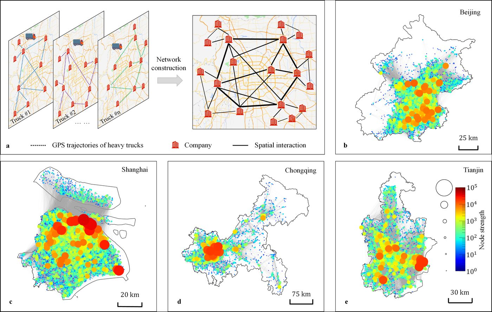
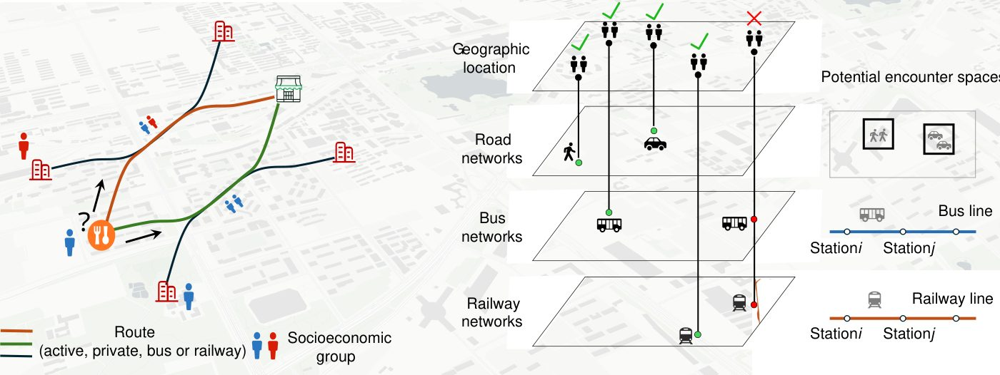
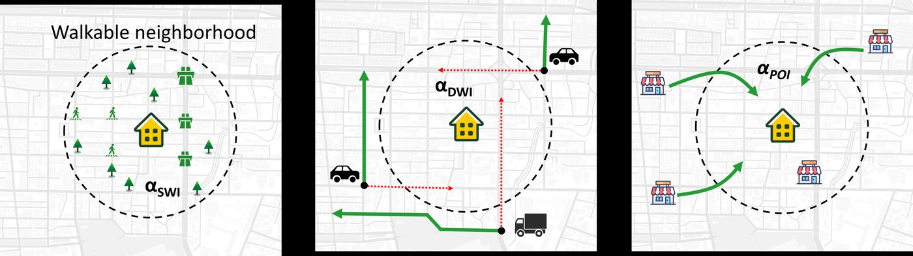
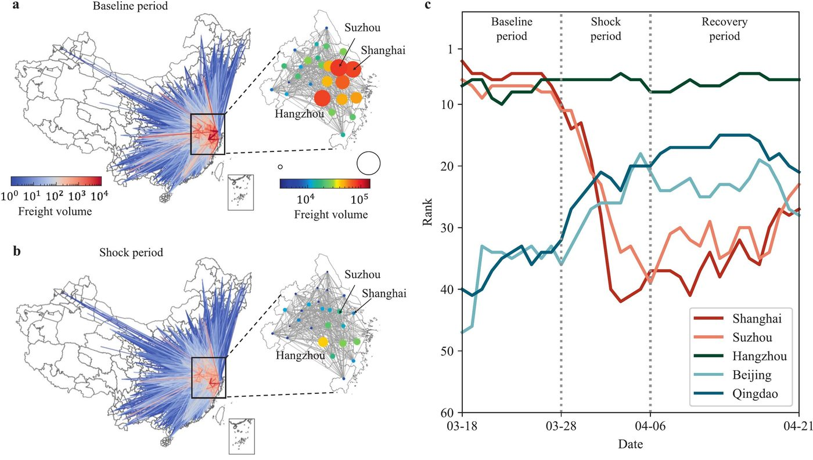

My research asks how people and goods move within and between cities, and what this means for the equity, sustainability and resilience of urban systems.

Human and freight mobility
------
I develop methods to turn large-scale GPS and mobile-phone trajectories into trips, networks and flows: identifying freight trip ends from heavy-truck GPS data, uncovering the structure and hierarchy of urban freight networks, modelling truck-tour decisions and estimating intercity freight flows with deep learning.

Equity
------
Using mobile-phone data for millions of residents, I study where and when people from different socioeconomic groups encounter each other across walking, road, bus and rail, and who bears the burden of urban traffic, from pedestrian exposure to freight spillover on neighborhoods.

Sustainability
------
My work on experienced walkability reconstructs 1.5 billion walking trips across 82 Chinese cities to show that places designed for walking are not always walkable in experience, and tests what this means for the 15-minute city. I also develop WalkGeoAI, open-source software that maps street-level pedestrian activity from global open data.

Resilience
------
I study how transport and urban systems respond to disruption: how freight networks reorganized during COVID-19 lockdowns, and, in ongoing work, how floods and extreme rainfall affect communities' access to everyday services and the economic ties between cities.

