

My research studies how people and goods move within and between cities, and what these movements mean for the equity, sustainability and resilience of urban systems. I work with large-scale GPS and mobile phone trajectories, combined with open geospatial data, network science and GeoAI.

<ul class="rs-toc">
<li><a href="#trajectory-analytics-and-geospatial-data-fusion">Trajectory analytics and geospatial data fusion</a></li>
<li><a href="#geoai-for-mobility-prediction">GeoAI for mobility prediction</a></li>
<li><a href="#structure-and-function-of-urban-freight-systems">Structure and function of urban freight systems</a></li>
<li><a href="#social-inequality-in-urban-mobility">Social inequality in urban mobility</a></li>
<li><a href="#walkability-and-the-15-minute-city">Walkability and the 15-minute city</a></li>
<li><a href="#resilience-of-urban-systems-under-disruption">Resilience of urban systems under disruption</a></li>
</ul>

<h2>Trajectory analytics and geospatial data fusion</h2>

Vehicle GPS trajectories record movement continuously but do not reveal where freight trips begin and end. We developed data-driven methods that derive stop and dwell-time criteria from the trajectories themselves rather than from fixed empirical thresholds, and that validate candidate trip ends against road networks, highways and freight points of interest. Applied to the GPS records of more than 2.6 million heavy trucks in China, these methods recover intracity freight trips with 88.8% accuracy and 18 million intercity trips nationwide. These trip data underpin the network, modeling and resilience studies below.

<figure><a href="/images/research/2022_trc_trip_ends.jpg">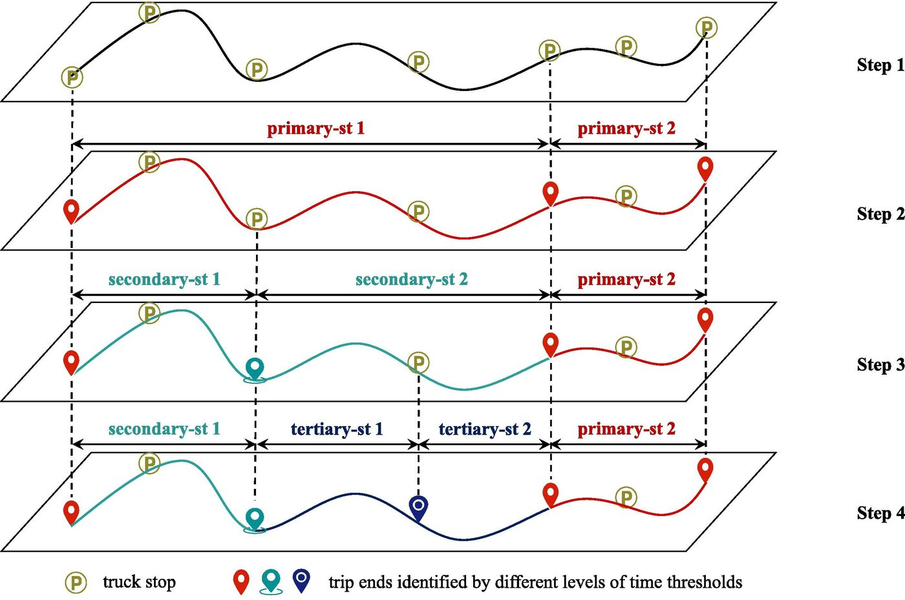</a>
Figure source: Yang Y, et al. (2022). Transportation Research Part C, 136, 103564. <a href="https://doi.org/10.1016/j.trc.2022.103564">[Paper]</a>
</figure>
<figure><a href="/images/research/2022_tre_intercity_trip_ends.jpg">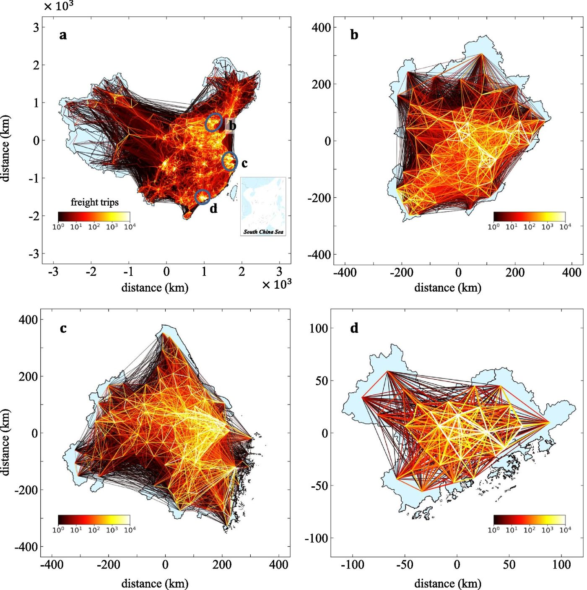</a>
Figure source: Yang Y, et al. (2022). Transportation Research Part E, 157, 102590. <a href="https://doi.org/10.1016/j.tre.2021.102590">[Paper]</a>
</figure>

<h2>GeoAI for mobility prediction</h2>

Detailed mobility data are available for few places and are often proprietary, which limits their use in planning. GeoAI can learn how observed mobility relates to the spatial characteristics of cities where data exist and extend this relationship to places where they do not. We apply this idea at two scales, intercity freight flows and street-level pedestrian activity, and in both cases examine not only predictive performance but also which urban features the models rely on.

<strong>Estimating intercity freight flows.</strong> We adapted the Deep Gravity framework to heavy truck flows among 368 prefecture-level cities in China, using features describing freight locations, markets, road networks and land use. The model substantially outperformed the classical gravity model. Explainable AI revealed heterogeneous and interacting effects across city pairs: integrated markets strengthen spatial effects at distances below about 300 km and weaken them beyond.

<figure class="rs-fig"><a href="/images/research/2023_tre_deep_gravity.jpg">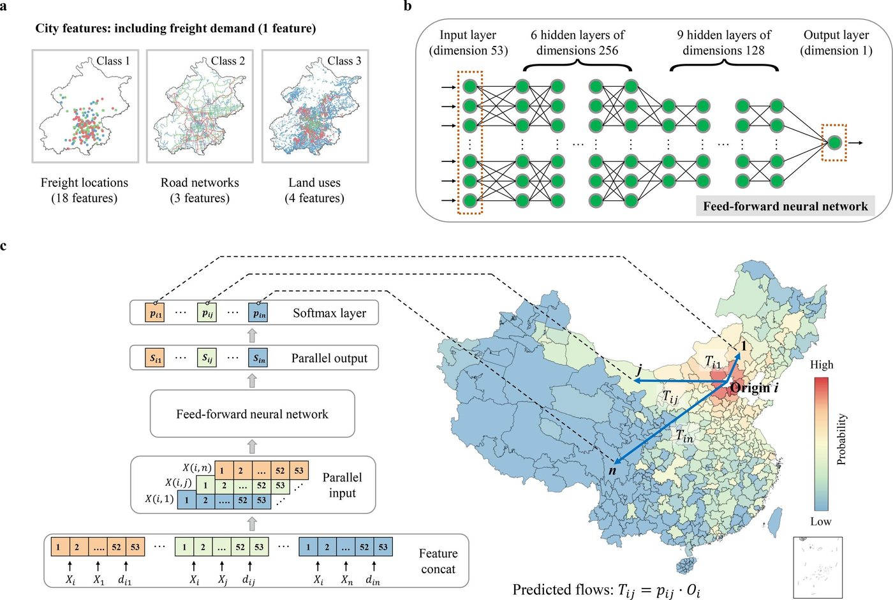</a>
Figure source: Yang Y, et al. (2023). Transportation Research Part E, 179, 103320. <a href="https://doi.org/10.1016/j.tre.2023.103320">[Paper]</a>
</figure>

<strong>Mapping street-level pedestrian activity.</strong> We developed WalkGeoAI, an open-source workflow that estimates within-city relative pedestrian activity from seven global open datasets using a pretrained gated graph convolutional network, without local labels or retraining. Evaluated through spatial cross-validation in New York and Beijing and against independent counts in London, Philadelphia and Melbourne, it has been deployed to more than 5.7 million road segments in 20 cities on six continents.

<figure class="rs-fig"><a href="/images/research/2026_ceus_walkgeoai.jpg">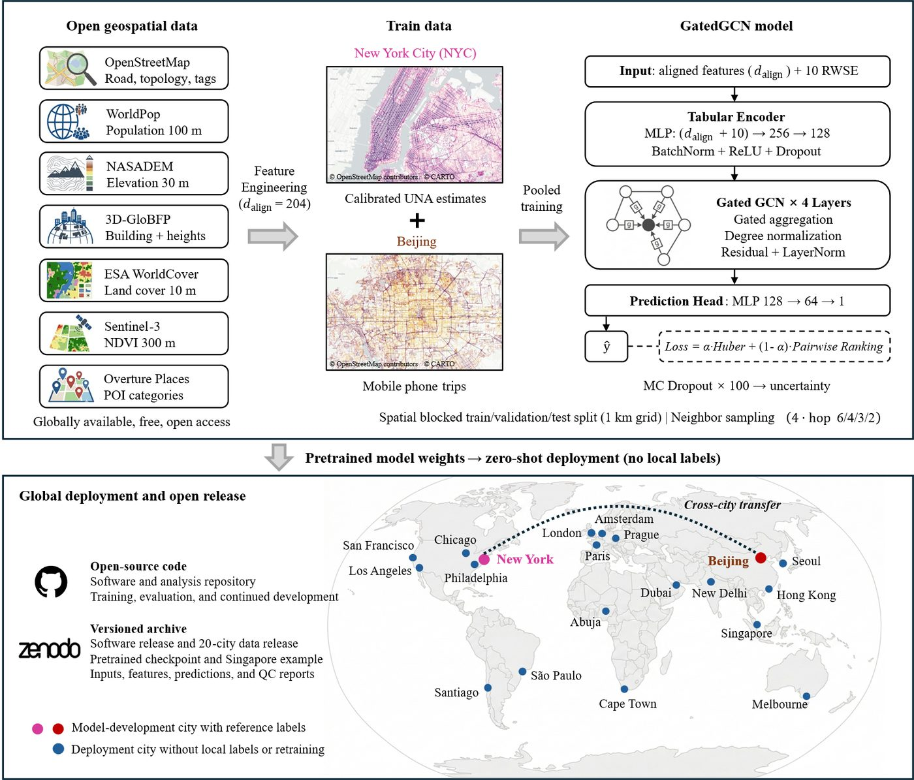</a>
Figure source: Yang Y, et al. (2026). Computers, Environment and Urban Systems (accepted). <a href="https://github.com/UrbanMobility-y/WalkGeoAI">[Code]</a>
</figure>

<h2>Structure and function of urban freight systems</h2>

Heavy trucks move goods between factories, warehouses, logistics facilities and construction sites, so their movements trace the spatial organization of the urban economy. We treat urban freight as a complex system and examine it from network structure to operational behavior: how freight networks are organized, how industries shape their communities, how truck activity spaces are divided across the city, and how logistics decisions determine tour structure. Combining empirical analysis with network growth and behavioral models, these studies link observed flows to the mechanisms that produce them.

<strong>Revealing the core structure of freight networks.</strong> From 41 billion GPS records in four Chinese cities, we reconstructed truck mobility networks between freight locations and found a hub-and-spoke core in which a few locations concentrate most interactions. A spatial network growth model reproduces this core from spatial distance, economic size and the replication of business patterns.

<figure class="rs-fig"><a href="/images/research/2024_trc_network_core.jpg">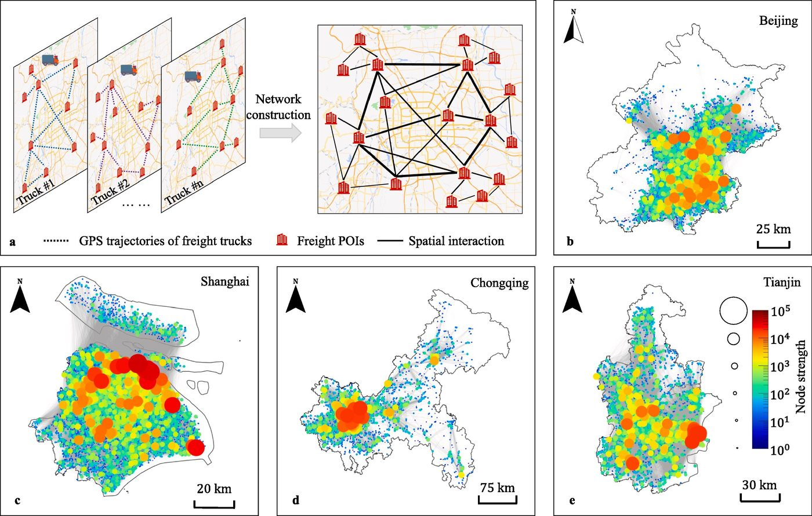</a>
Figure source: Yang Y, et al. (2024). Transportation Research Part C, 158, 104442. <a href="https://doi.org/10.1016/j.trc.2023.104442">[Paper]</a>
</figure>

<strong>Uncovering the industrial organization of freight flows.</strong> Using Infomap community detection, we found that freight locations form clusters with distinct industry concentrations, and that locations of the same category play different roles across industries. A bottom-up growth model based on the spatial agglomeration of industrial clusters reproduces the observed hierarchy of truck flows.

<figure class="rs-fig"><a href="/images/research/2023_tre_hierarchy.jpg">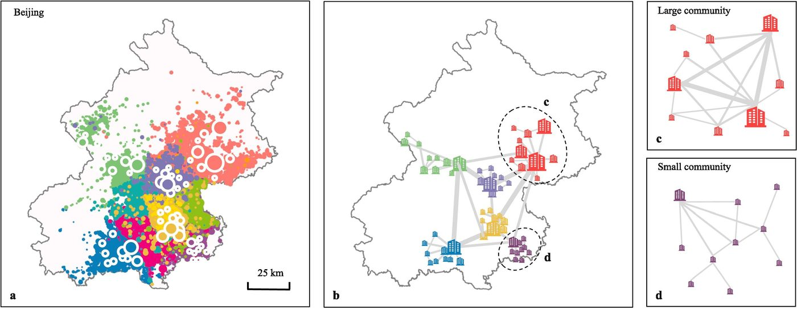</a>
Figure source: Yang Y, et al. (2023). Transportation Research Part E, 179, 103318. <a href="https://doi.org/10.1016/j.tre.2023.103318">[Paper]</a>
</figure>

<strong>Measuring segregation in freight mobility.</strong> Applying a freight segregation index to the GPS data of 2.7 million trucks, we found that truck groups serving high-demand areas rarely overlap with those serving low-demand areas. As segregation increases, tour patterns first diversify and then become more repetitive and less exploratory, and truck groups show distinct industry preferences.

<figure class="rs-fig"><a href="/images/research/2024_scs_segregation.jpg">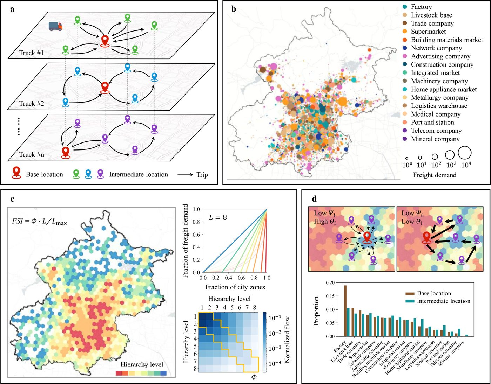</a>
Figure source: Yang Y, et al. (2024). Sustainable Cities and Society, 113, 105699. <a href="https://doi.org/10.1016/j.scs.2024.105699">[Paper]</a>
</figure>

<strong>Modeling truck tour decisions.</strong> GPS data reveal movements but not the logistics decisions behind them. Using Dutch carrier and shipment data, we classified more than 1,000 tour patterns into direct, sequential and complex tours and modeled their choice with random parameters logit models with heterogeneity in means and variances. Weekend shipments, transshipment terminals and freight sector strongly influence tour choice, with effects that vary across shipments.

<figure class="rs-fig"><a href="/images/research/2026_tp_tours.jpg">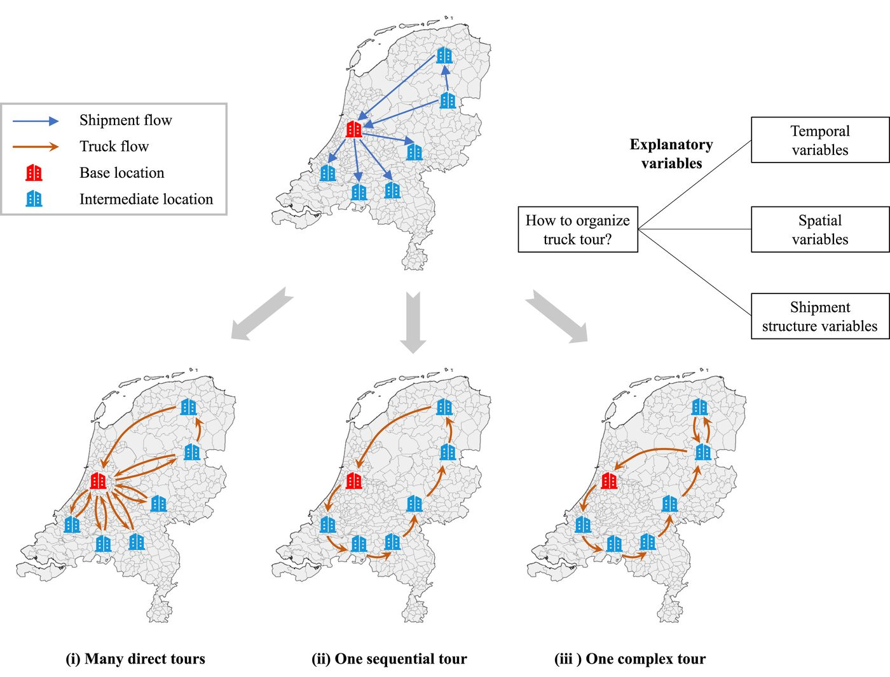</a>
Figure source: Yang Y, et al. (2026). Transport Policy, 178, 103958. <a href="https://doi.org/10.1016/j.tranpol.2025.103958">[Paper]</a>
</figure>

<h2>Social inequality in urban mobility</h2>

Segregation and environmental inequality are usually measured at places of residence, yet daily mobility determines whom people encounter and which neighborhoods are exposed to traffic. Using mobile phone and truck trajectories, we examine two dimensions of inequality in urban mobility. The first is social mixing: how far residents of different socioeconomic status share transport infrastructure across modes, places and times of day. The second is the spatial distribution of the external costs of freight transport across neighborhoods.

<strong>Measuring social mixing across transport modes.</strong> We treated walking, road, bus and rail as parallel layers of encounter and introduced mode-specific mixing and multimodal uniformity indices, applied to mobile phone data for 11 million people in Beijing. Rail produces the highest mixing while active travel remains locally sorted, and an OD-preserving null model confirms that rail has the smallest mixing deficit. Segregation intensifies in peripheral zones and during commuting hours.

<figure class="rs-fig"><a href="/images/research/2026_epjds_mixing.jpg">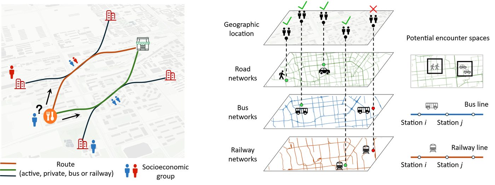</a>
Figure source: Yang Y, et al. (2026). EPJ Data Science. <a href="https://doi.org/10.1140/epjds/s13688-026-00697-4">[Paper]</a>
</figure>

<strong>Examining socioeconomic diversity in public transport.</strong> Reconstructing station-by-station trajectories of 8.3 million users, we measured diversity both at destinations and among riders along each corridor. Two paradoxes emerge: moderate accessibility gains correspond to lower diversity, and buses become less diverse at peak hours while subways remain diverse throughout the day, reflecting their hub-based structure and capacity.

<figure class="rs-fig"><a href="/images/research/2026_us_transit_diversity.jpg">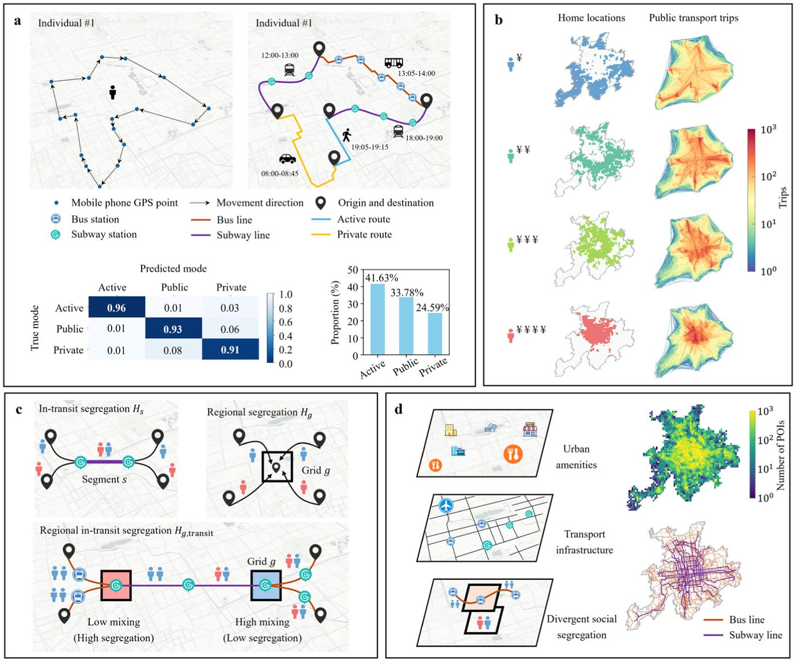</a>
Figure source: Yang Y, et al. (2026). Urban Studies. <a href="https://doi.org/10.1177/00420980261460340">[Paper]</a>
</figure>

<strong>Assessing freight spillover on neighborhoods.</strong> Combining the activity spaces of more than 2.6 million trucks with network analysis, we showed that neighborhoods with low freight demand can still experience substantial spillover from truck activity in freight hotspots. A gravity-based exploration and preferential return model reproduces the routing behavior behind these spillovers and is used to evaluate mitigation strategies.

<figure class="rs-fig"><a href="/images/research/2025_scs_spillover.jpg">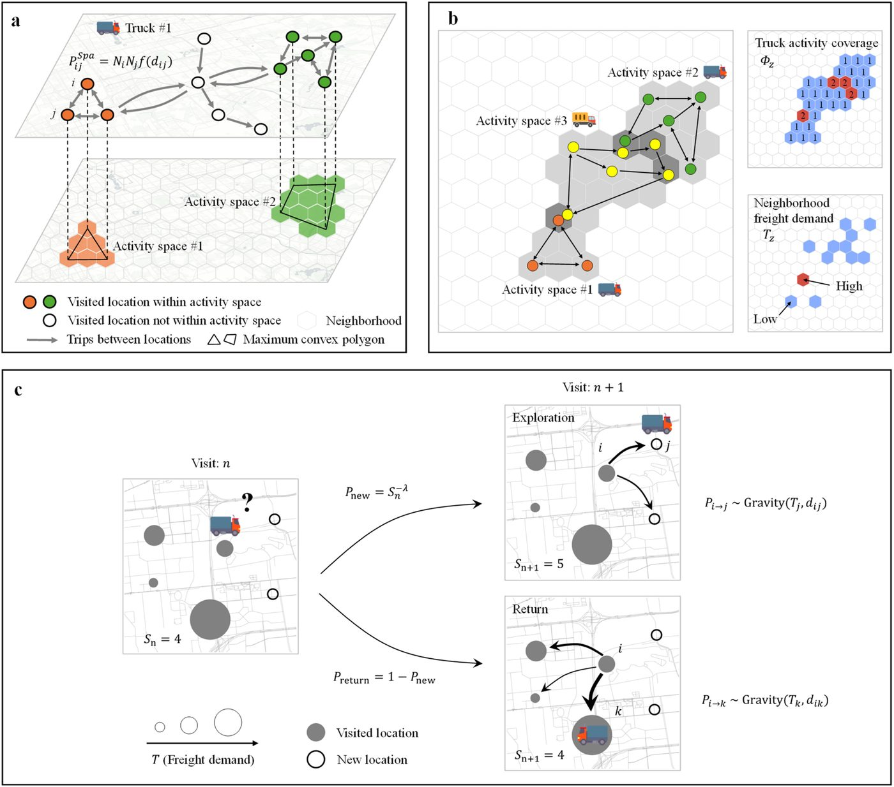</a>
Figure source: Yang Y, et al. (2025). Sustainable Cities and Society, 135, 107032. <a href="https://doi.org/10.1016/j.scs.2025.107032">[Paper]</a>
</figure>

<h2>Walkability and the 15-minute city</h2>

Walkable neighborhoods and the 15-minute city seek to place daily activities within walking distance, but walkability is usually assessed from static attributes of places such as connectivity, amenity density and greenery. We assess experienced walkability by combining these static conditions with the time-varying traffic that pedestrians encounter along reconstructed walking routes. This allows us to test whether places that are walkable by design are also walkable in use, and how the gap varies with urban form and across social groups.

<strong>Revealing the density paradox of walkability.</strong> Across 1.50 billion walking trips in 82 Chinese cities, with traffic from private vehicles, heavy trucks and buses resolved at five-minute intervals, we found a systematic decoupling between built environment quality and traffic exposure. Dense, amenity-rich places support walking through proximity but expose pedestrians to heavier traffic, a trade-off that is stronger in monocentric cities. Scenario experiments show that localizing amenities improves pedestrian experience in polycentric settings but can worsen it in monocentric ones.

<figure class="rs-fig"><a href="/images/research/2026_nc_walkability.jpg">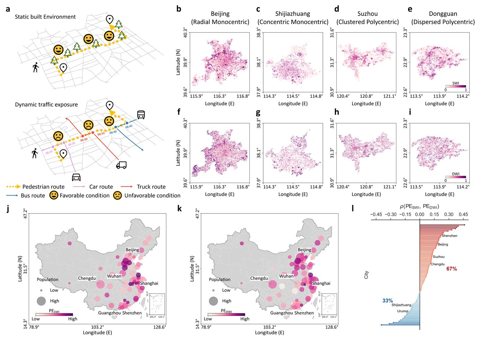</a>
Figure source: Yang Y, et al. (2026). Nature Communications (accepted).
</figure>

<strong>Measuring pedestrian exposure to traffic.</strong> Integrating mobile phone trajectories, heavy truck GPS data and transit schedules in Beijing, we built road-, location- and trip-level exposure indices for cars, trucks and buses. Higher-income groups face intense car exposure in amenity-rich central areas, whereas lower-income groups bear a disproportionate share of truck traffic. Modeling traffic avoidance reveals an access gap that reduces the practical reach of the 15-minute city.

<figure class="rs-fig"><a href="/images/research/2026_ceus_exposure.jpg">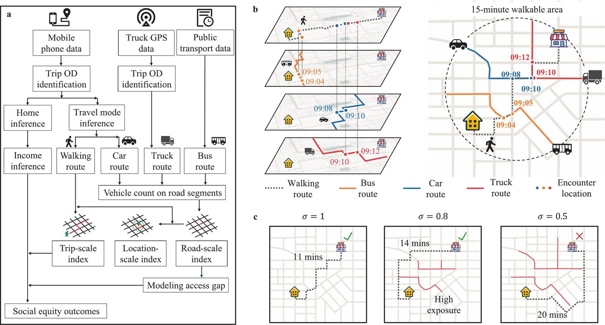</a>
Figure source: Yang Y, et al. (2026). Computers, Environment and Urban Systems, 129, 102480. <a href="https://doi.org/10.1016/j.compenvurbsys.2026.102480">[Paper]</a>
</figure>

<h2>Resilience of urban systems under disruption</h2>

Disruptions reveal how freight systems absorb and redistribute stress. We use individual truck trajectories and highway toll records to observe these responses directly, rather than inferring them from aggregate socioeconomic data. The COVID-19 pandemic allows us to examine three scales: freight demand between cities, the operating efficiency of urban truck networks, and the reorganization of national flows after the shutdown of a major hub. Across these scales, spatial structure is associated with how freight systems adapt.

<strong>Modeling pandemic impacts on intercity freight.</strong> Using GPS data from more than 2.7 million trucks one week before and after the outbreak, we quantified structural changes in intercity freight demand with spatial statistics and developed an interpretable machine learning model of freight trip generation. The factors shaping truck movements changed significantly at local and regional scales, with city-specific challenges, and the model offers a tool for estimating freight demand in future crises.

<figure class="rs-fig"><a href="/images/research/2024_trc_covid_intercity.jpg">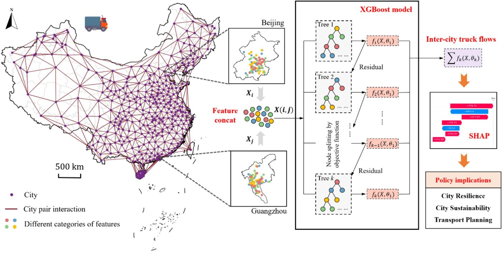</a>
Figure source: Yang Y, et al. (2024). Transportation Research Part C, 169, 104861. <a href="https://doi.org/10.1016/j.trc.2024.104861">[Paper]</a>
</figure>

<strong>Assessing urban freight network resilience.</strong> In Wuhan, Beijing, Shanghai and Guangzhou, we compared truck transport networks before and during the pandemic using two metrics, handling efficiency and transport efficiency, across regions, freight hubs and industry supply chains. Suburban hubs and critical industries maintained efficiency better, while urban hubs and non-essential sectors faced greater disruption.

<figure class="rs-fig"><a href="/images/research/2025_tre_resilience.jpg">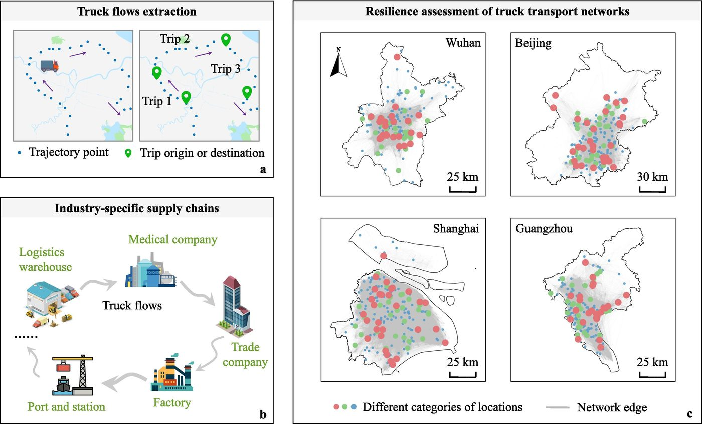</a>
Figure source: Yang Y, et al. (2025). Transportation Research Part E, 197, 104087. <a href="https://doi.org/10.1016/j.tre.2025.104087">[Paper]</a>
</figure>

<strong>Uncovering cascading adaptation.</strong> Analyzing 701 million highway toll records covering 339 cities during the 2022 Shanghai lockdown, we found that freight flows reorganized sequentially: secondary hubs such as Hangzhou absorbed displaced flows and peripheral cities exceeded baseline activity. Direct dependence on Shanghai poorly predicted disruption, and polycentric regions recovered faster than hub-centric ones.

<figure class="rs-fig">
Figure source: Yang Y, et al. (2026). Transportation Research Part E, 211, 104906. <a href="https://doi.org/10.1016/j.tre.2026.104906">[Paper]</a>
</figure>

