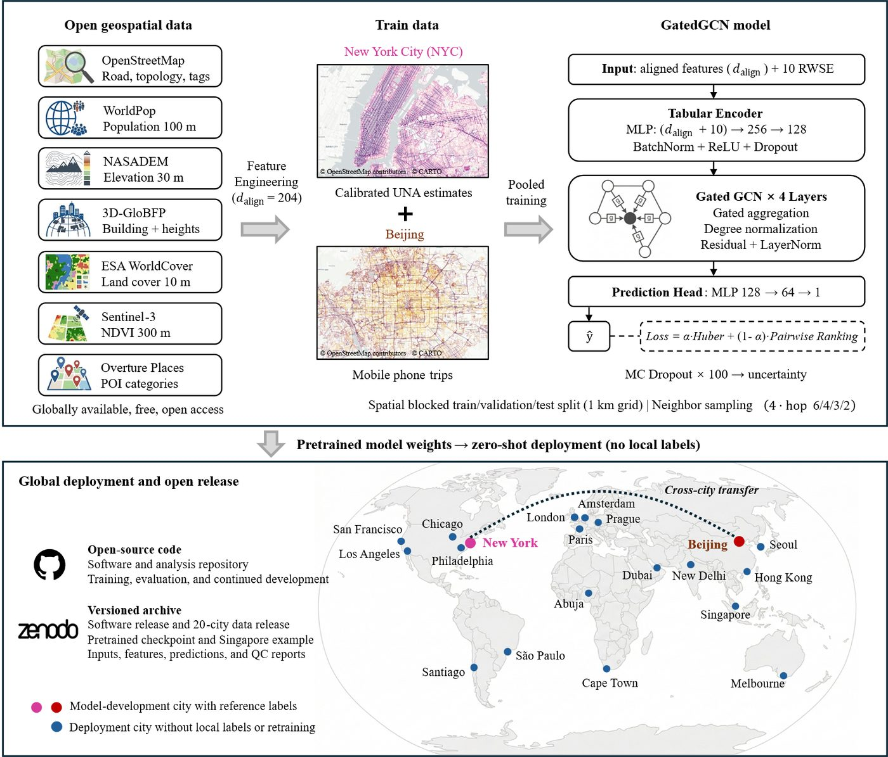

Code is released under the MIT License and data under CC BY 4.0, unless stated otherwise.

<h2 id="software">Software</h2>

<h3>WalkGeoAI</h3>

Open-source software that estimates within-city relative pedestrian activity on every street segment from seven global open datasets. A pretrained gated graph convolutional network completes the road network without local labels or retraining.

Release v1.0.1 · Python · pretrained model and outputs for 20 cities on six continents

<a class="sd-btn" href="https://github.com/UrbanMobility-y/WalkGeoAI">GitHub</a><a class="sd-btn" href="https://doi.org/10.5281/zenodo.24030782">Zenodo</a><a class="sd-btn" href="/publications/">Paper</a>

<h2 id="code-and-data">Code and data for publications</h2>

<table class="sd-tab">
<thead><tr><th>Study</th><th>Code</th><th>Data</th></tr></thead>
<tbody>
<tr><td class="s">Experienced walkability and the paradox of urban density in Chinese cities. <em>Nature Communications</em> (accepted)</td>
<td><a href="https://github.com/UrbanMobility-y/Walkability">Walkability</a></td>
<td><a href="https://doi.org/10.5281/zenodo.17965001">Source data (Zenodo)</a></td></tr>
<tr><td class="s">WalkGeoAI: Open-source software for estimating street-level relative pedestrian activity using global geospatial data. <em>Computers, Environment and Urban Systems</em> (accepted)</td>
<td><a href="https://github.com/UrbanMobility-y/WalkGeoAI">WalkGeoAI</a></td>
<td><a href="https://doi.org/10.5281/zenodo.24030782">Model and 20-city outputs (Zenodo)</a></td></tr>
<tr><td class="s"><a href="https://doi.org/10.1140/epjds/s13688-026-00697-4">Multi-layered segregation in urban transportation systems.</a> <em>EPJ Data Science</em> (2026)</td>
<td><a href="https://github.com/UrbanMobility-y/multimodal-segregation">multimodal-segregation</a></td>
<td><a href="https://github.com/UrbanMobility-y/multimodal-segregation/tree/main/Source%20data">Source data (GitHub)</a></td></tr>
<tr><td class="s"><a href="https://doi.org/10.1016/j.compenvurbsys.2026.102480">A computational framework for measuring dynamic vehicular exposure and equity in the 15-min city.</a> <em>Computers, Environment and Urban Systems</em> (2026)</td>
<td><a href="https://github.com/UrbanMobility-y/dve">dve</a></td>
<td>—</td></tr>
</tbody>
</table>

<h2 id="datasets">Datasets</h2>

<ul class="sd-list">
<li><strong>Yang Y</strong>, Liu E, Jia B, Cheng S, Manley E (2026). Source data for “Experienced walkability and the paradox of urban density in Chinese cities”. <em>Zenodo</em>. <a href="https://doi.org/10.5281/zenodo.17965001">doi.org/10.5281/zenodo.17965001</a></li>
<li><strong>Yang Y</strong>, He D, Gu Y, He H, Huang W (2026). WalkGeoAI: software, pretrained model and street-level outputs for 20 cities (v1.0.1). <em>Zenodo</em>. <a href="https://doi.org/10.5281/zenodo.24030782">doi.org/10.5281/zenodo.24030782</a></li>
<li>Gao L, Song D, <strong>Yang Y</strong>, Xu C, Yang X (2022). District/county-level population census GIS datasets in China (1953–2010). <em>Science Data Bank</em>. <a href="https://doi.org/10.11922/sciencedb.j00001.00273">doi.org/10.11922/sciencedb.j00001.00273</a></li>
</ul>
